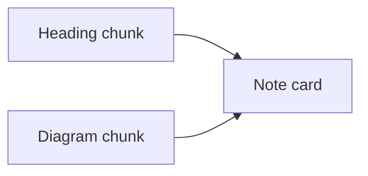

## What I found before planning

```callout
id: findings
kind: note
title: The facts this plan rests on
body: |
  The heading above this note and the diagram below it render inside this note.

  `parsePlan` in `src/parse.ts` emits one block for each stretch of markdown between fences. `renderBlock` in `src/render.ts` wraps every block in `<section class="block">`, and `.stack` lays those sections out with a gap. That is the whole split.

  - A markdown chunk that is only headings (`#`, `##`, `###`, blank lines) is a title card. It should render at the top of the next card.
  - A markdown chunk that is only mermaid fences is a diagram card. It should render at the bottom of the previous card.
  - A chunk that already mixes a heading, prose, or a diagram stays one card. Nothing about that chunk changes.
  - A lone `#` heading that repeats the hero title is dropped. The hero already shows `plan.title`.
  - A heading with no following card, or a diagram with no previous card, keeps a card of its own.
```



```phase
id: group
title: Attach stray headings and diagrams
status: done
body: |
  Add a grouping pass in front of `renderBlock`. Walk the blocks once and build the cards that actually paint.

  - Hold a heading-only chunk until the next card, then paint those headings at the top of that card, inside the same `<section class="block">`.
  - Append a diagram-only chunk to the previous card's body. It does not count as a gap between neighbors.
  - Leave a mixed markdown chunk as its own card.
  - Keep `diff-*` on the fragment that moved, and keep `data-plan-ref` on the card that already had an anchor. Heading and diagram chunks have no anchor today.

  Choices, questions, forms, and approvals stay one card each. They are never merged with each other. A heading immediately above one of them still moves inside it, and a diagram immediately below one of them still moves inside it.
```

```phase
id: wrap
title: Wrap a run of steps in one card
status: done
body: |
  After attachment, consecutive `phase` blocks share one card.

  - Two or more phases in a row render as one `<section class="block phase-group">`.
  - Each phase inside it keeps its rail, status, title, body, and `data-plan-ref`, without a second background, border, shadow, or outer radius. A divider separates steps.
  - A phase that is not next to another phase stays the single `.block.phase` card it is today.
  - A callout, choice, question, form, approval, checklist, or workflow between phases ends the run. Those blocks stay their own cards.
  - The three steps in this plan are one run, so they become one card. The note above them does not join that card.
```

```phase
id: prove
title: Cover the three screenshots
status: done
body: |
  Extend `test/parse.test.ts` through `renderPlanPage`.

  - A heading-only chunk before a callout produces one `.block.callout`. The heading markup is inside it. There is no `.block.markdown` for that heading.
  - A diagram-only chunk after a callout is inside that callout. There is no following `.block.markdown`.
  - Two choice blocks still produce two `.block.interaction.choice` sections. Two questions blocks stay two sections.
  - Three consecutive phases produce one `.block.phase-group` with three `[data-plan-ref]` nodes. One phase alone stays `.block.phase`.
  - A markdown chunk that already contains prose and a mermaid fence still renders as one card, and a mermaid fence inside a phase body stays in that phase.
```

```checklist
title: Done when
items:
  - id: heading
    text: A title-only chunk renders inside the card below it
    done: true
  - id: diagram
    text: A diagram-only chunk renders inside the card above it
    done: true
  - id: decisions
    text: Choices and questions stay separate cards
    done: true
  - id: steps
    text: A run of steps shares one card, and a single step stays one card
    done: true
  - id: anchors
    text: Phase and interaction anchors still resolve from the workflow
    done: true
  - id: tests
    text: Card grouping tests in test/parse.test.ts pass
    done: true
```

```workflow
id: card-continuity
title: Expected execution
nodes:
  - id: findings
    ref: findings
    label: Confirm the split
  - id: group
    ref: group
    label: Attach headings and diagrams
  - id: wrap
    ref: wrap
    label: Wrap step runs
  - id: prove
    ref: prove
    label: Cover the three screenshots
edges:
  - from: findings
    to: group
  - from: group
    to: wrap
  - from: wrap
    to: prove
```
