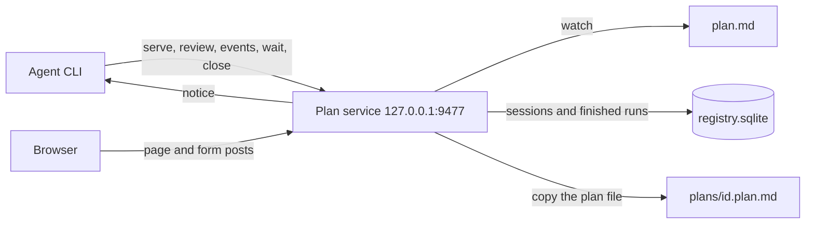
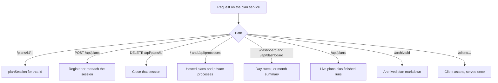
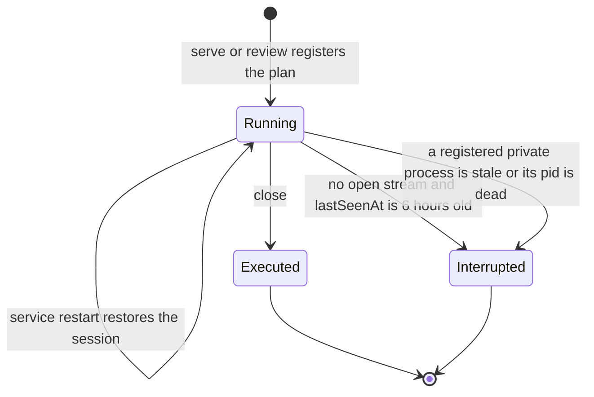
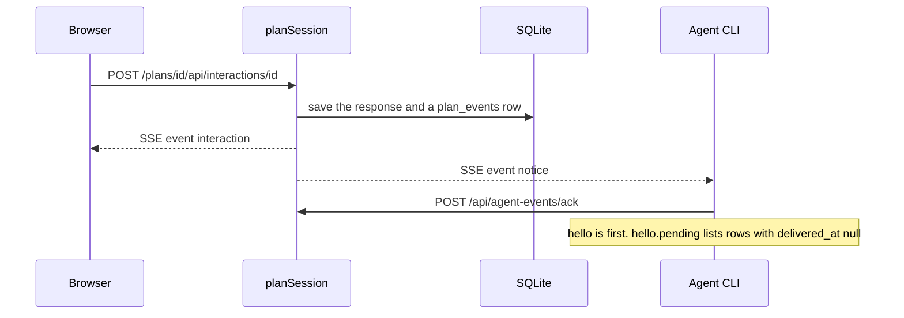
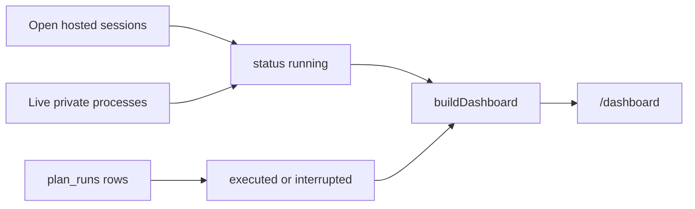

# Architecture

Visual Living Plan is a local HTTP service plus a browser page. An agent writes one `.plan.md` file. A person opens a URL on that service to watch status and submit choices, forms, questions, approvals, and reviews. The agent hears those submissions on an event stream.

Read [the decisions](decisions/README.md) for why it is shaped this way. Read [the project context](../context.md) before changing the code.

## How the pieces talk

A single Bun process listens on `127.0.0.1:9477`. `serve` and `review` start it when it is not already running, then register a plan. That process is detached into its own session. It keeps running after `serve`, `review`, `events`, `watch`, `wait`, `dashboard`, and `tui` exit, and after the terminal that started them closes. `serve` is a client of that plan. It prints undelivered submissions and exits. The page stays up. `review` waits for the decision and leaves the plan open. Approve and deny set that session back to watch. Iterate leaves it in review, hides the verdict bar, and marks comments that are not yet addressed as in progress ([ADR 0013](decisions/0013-iterate-keeps-review.md)). `live-plan mode` moves the same session between watch, comment, and review, and the open tab follows.

The printed URL is the bind address ([ADR 0016](decisions/0016-loopback-address.md)). On the default host that is `http://127.0.0.1:9477/plans/<id>/`. The CLI dials `127.0.0.1` and does not resolve `*.local`. `--host` other than loopback is unchanged, so a cloud agent can still share a reachable address.

LAN publishing is off until `live-plan lan on` ([ADR 0019](decisions/0019-lan-publishing.md)). That command stores the choice under `~/.config/living-plan`, listens on all interfaces when no non-loopback `--host` was set, and advertises `living-plan.local` at a private LAN address. The registry lock still tells the CLI to dial `127.0.0.1`, so `serve` and `review` keep printing the loopback plan URL. The LAN URL, printed only by `lan on` and `lan status`, carries a secret. Visiting it sets a cookie. A non-loopback request without that cookie or secret gets 401 on plan pages and plan APIs. Loopback stays open. The agent stream still requires its bearer token. `lan off` withdraws the announcement, removes a firewall rule this tool added, and binds `127.0.0.1` again.

`--cloud` is a separate host ([ADR 0022](decisions/0022-opt-in-cloud-host.md)). `account login` stores an account bearer in `~/.config/living-plan/cloud.json`. `serve --cloud` and `review --cloud` register the plan on that Worker, write `cloudId` into the plan frontmatter, and keep the plan bearer in `cloud.json`. They do not start the local registry. The page and the agent share a WebSocket on one SQLite Durable Object. `dashboard`, `tui`, `logs`, and `lan` stay local. The web application is TanStack Start at the repository root ([ADR 0023](decisions/0023-tanstack-start-page.md)). The browser still compiles the plan MDX and mounts the same React entries. The Worker keeps the account, the Durable Object, and every plan API. `npm run host` runs that application on local workerd. Setup for the Worker bindings is [cloud/README.md](../../cloud/README.md).

Each plan is a session under `/plans/<id>/`. The id is a stable hash of the plan path, so registering the same file again returns the same URL.

`--no-registry` does not use this service. It starts one private server for that plan, at the root of its own port. Tests and one-shot runs use that path. That process is the server. The page stops when `serve` exits, and when `review` finishes on approve or deny. Iterate leaves the private process running. The server does not register itself in the plan list. It proxies `GET /api/processes` to the service when a registry URL was passed in, so the Plans panel still works. The agent stream on that server does not require a token.

## Where a request goes

`src/registryService.ts` is an Elysia app, bound with Bun. Each path is a route handler. Paths under `/plans/<id>/` resolve that session in `src/planHost.ts` and run the handlers in `src/planRoutes.ts`. `src/planSession.ts` holds the plan state and both event streams. Everything else is the catalog, the dashboard, or shared assets.

| Surface | Path |
|---|---|
| Plan page | `/plans/<id>/` (`/plans/<id>` redirects here) |
| Plan API | `/plans/<id>/api/plan`, `/api/interactions/:id`, `/api/comments`, `/api/comments/:id/address`, `/api/comments/:id/addressing`, `/api/comments/:id/reply`, `/api/review`, `/api/mode`, `/api/execution` (GET, PUT, `/start`, `/stop`), `/api/theme` (GET, PUT) |
| Browser events | `/plans/<id>/api/events` |
| Agent events | `/plans/<id>/api/agent-events` (bearer token) and `POST /api/agent-events/ack` |
| Plan list | `/api/processes` and `GET /` |
| Private registration | `POST /api/processes`, `POST /api/processes/:id/heartbeat`, `DELETE /api/processes/:id` |
| Dashboard | `/dashboard` and `/api/dashboard?period=day\|week\|month` |
| Logs | `GET /api/logs` for the service, and `GET` and `POST /plans/<id>/api/logs` for one plan |
| Finished runs | `GET /api/plans` |
| Archived plan file | `/archive/<id>` |
| Health | `GET /api/health` |
| Client assets | `/client/...` once, for every plan |

Browser API calls from a hosted page are prefixed with `/plans/<id>`. Root `/api/...` on the service is the catalog, the dashboard, and the service log, not a plan. `new URL('/api/plan', planUrl)` is wrong when the plan URL has a path. The CLI uses `planApiUrl` in `src/agentEvents.ts`.

## Logs

Errors, warnings, and logs for development are files under `~/.config/living-plan/logs` ([ADR 0015](decisions/0015-service-logs.md)). winston writes one registry file per local day and one file per plan. The page posts browser console output and script errors to `POST /plans/<id>/api/logs` and does not render them. `live-plan logs` prints the files and does not need a running service. `GET /api/logs` reads today's registry file. Nothing in the log is a submission, so `events` does not print it. A restart leaves the files in place.

## Session lifecycle

An open session is **running**. It is restored from SQLite when the service starts, as long as the plan file is still on disk.

`live-plan close --url <plan-url>` and `DELETE /api/plans/<id>` close one hosted plan immediately and record it as executed. `review` records the decision and leaves the plan open. Approve and deny set the mode to watch. Iterate leaves the mode on review. A session with no open browser stream and no open agent stream is closed as interrupted once `lastSeenAt` is 6 hours old. Requests and new streams refresh that time. An open stream keeps the session up even when the timestamp is older. A private server registered with `POST /api/processes` is removed from the live list and recorded as interrupted when its heartbeat is older than 20 seconds, or when its pid is gone. `--no-registry` does not write that row.

Registering a path that is still open reattaches to that session. `serve` does not change a session that is already in comment or review. After the session is closed, registering the same path opens a new running session with the same id. The earlier run stays in `plan_runs`.

## How a person and an agent meet

The browser posts a submission to `/api/interactions/:id`, `/api/comments`, or `/api/review`. The session stores it and tells open browsers with an event named `interaction`, `comment`, or `review`. It writes a `notice` to every agent subscribed to `/api/agent-events`. The same named events are also copied onto the agent stream. The CLI reads `hello` and `notice`. A `notice` carries `event` of `interaction`, `review`, or `comment`.

`hello` on the agent stream carries the mode, pending interaction ids, responses, review, comments, execution, and `pending`. `pending` is the `plan_events` rows for that plan whose `delivered_at` is null, in `seq` order. `serve` and `events` print each of those as one JSON line, ack them, and exit. When none are pending they wait for the next `notice`, print it, ack it, and exit. `watch` sets watch mode and stays connected for the execution that follows an approval. It prints later submissions and does not exit. A client subscribed to a different plan does not see them. `wait` returns when the matching interaction id arrives. `review` returns when the review `notice` arrives and leaves the plan open. Both ack the row they return. `mode` switches that session among watch, comment, and review. The browser stream carries the same `mode` event, so an open tab updates in place. `--detach` registers without subscribing.

The agent stream on the shared service requires the plan token or the service token. The CLI reads the service token from `~/.config/living-plan/registry.json` when `--token` is omitted. Browser submission routes stay open without that token on loopback. With LAN publishing on, a non-loopback peer also needs the LAN secret before a plan page or plan API succeeds. The agent stream still checks the bearer token on every peer.

While execution is active, plan forms and review return HTTP 409. Comments stay open. Addressing a comment (`POST /api/comments/:id/addressing` or `POST /api/comments/:id/address`) updates that comment and does not insert a new `plan_events` row. Address stores an outcome of `implemented` (the default), `errored`, or `issues`. `POST /api/comments/:id/reply` appends an agent reply to that same comment and also does not insert a `plan_events` row ([ADR 0014](decisions/0014-comment-replies.md)). `live-plan addressing` sets `addressingAt` (the page shows Addressing or Working). `live-plan reply` appends the reply text. `live-plan address` sets `addressedAt` and the outcome (the page shows Addressed, or Implemented, Errored, or Had issues on a minibar message). The reply is saved with the session and shown on the messages minibar or that part's comment thread.

## Dashboard

`/dashboard` summarizes running, executed, and interrupted plans for the local day, week, or month. The page is `src/dashboardPage.ts`. The grouping is `src/dashboard.ts`. `live-plan tui` is that registry in the terminal: the running-plan list from `GET /api/processes`, and the same `GET /api/dashboard` payload with running plans listed first. Starting it starts the service when none is running. Quitting the terminal leaves the service up.

A row overlaps the selected window when it started before the end of the window and is still running, or its end falls inside the window. Finished runs are stored in `plan_runs` with typed `started_at` and `ended_at` columns. `GET /api/dashboard` selects that window in Drizzle: `started_at` is at or before the window end, and `COALESCE(ended_at, heartbeat_at, started_at)` is at or after the window start. Open sessions and live private processes stay in memory. A running row overlaps when it started before the window end. A finished in-memory row uses `ended_at`, then `heartbeat_at`. Completion counts phases marked done plus interactions that already have an answer (`src/planProgress.ts`). Files modified is the git change count captured with the run. The plan markdown copied into the registry home is linked from the table at `/archive/<id>`.

## What lives where

| Module | Role |
|---|---|
| `src/planSession.ts` | One plan: plan-file and theme-config watch, parsed document, responses, comments, execution, review, submission log, browser events, agent events |
| `src/configHome.ts` | XDG `~/.config/living-plan` resolution, env overrides, and legacy home migration |
| `src/serviceLog.ts`, `src/clientLog.ts` | Development log files under `~/.config/living-plan/logs`, and the page script that posts console output into them |
| `src/planRoutes.ts` | Elysia routes for one plan, at the origin or under `/plans/<id>/` |
| `src/planHost.ts` | All sessions on the service: register, reattach, close, idle timeout, git snapshot cache, dashboard rows for open sessions |
| `src/registryService.ts` | The Elysia app: health, plan list, registration, dashboard, archive, and the hosted plan routes |
| `src/registryStore.ts` | SQLite through Drizzle: `plans` for private servers, `plan_sessions` for live hosted plans, `plan_events` for submissions, `plan_runs` for finished runs |
| `src/db/schema.ts`, `src/db/migrate.ts` | Table definitions and the SQL that creates them, including the copy from the older `processes` table |
| `src/server.ts` | The private one-plan Elysia app used by `--no-registry` |
| `src/httpServer.ts` | Binds an Elysia app with `Bun.serve` so event streams stay open |
| `src/localName.ts` | Loopback checks and HTTP origin formatting |
| `src/lanConfig.ts`, `src/lanAddress.ts`, `src/lanAccess.ts`, `src/lanFirewall.ts`, `src/lanCommand.ts` | Opt-in LAN preference, address choice, cookie gate, firewall rule, and `lan` commands |
| `src/mdnsPacket.ts`, `src/mdnsPublish.ts` | DNS-SD announcement for `living-plan.local` while LAN mode is on |
| `src/cli.ts` | Client of the service. `serve` registers and prints that plan's undelivered submissions. `events`, `wait`, `watch`, and `review` read the same stream. `logs` prints the diagnostic files under `~/.config/living-plan/logs`. `dashboard` opens `/dashboard`. `tui` reads `/api/processes` and `/api/dashboard`, and leaves the service running when it exits. `--cloud` uses the signed-in host instead |
| `src/cloudStore.ts`, `src/cloudClient.ts`, `src/cloudCommand.ts`, `src/cloudWatch.ts`, `src/cloudFrontmatter.ts` | Account session and plan bearers in `cloud.json`, frontmatter `cloudId`, upload, and the file watcher for `--cloud` |
| `src/agentEvents.ts` | SSE reader for a local plan, WebSocket reader for a cloud plan, ack helper, and `planApiUrl` used by the CLI |
| `cloud/` | The Worker session: Better Auth on D1, one SQLite Durable Object per plan, and the plan APIs |
| `src/routes/`, `src/entry.ts` | The web application. TanStack Start on that Worker. Every page is a route here, and the session stays in `cloud/` |
| `src/dashboard.ts`, `src/dashboardPage.ts`, `src/tui/` | Period summary, the dashboard page, and the terminal view of the same read |
| `src/planArchive.ts` | Copy a plan file into the registry home and serve that copy |
| `src/parse.ts`, `src/planMdx/outline.ts` | Parse MDX plan components for the session model (interactions, workflow, progress). `` and YAML entry fences are rejected ([ADR 0021](decisions/0021-mdx-plan-entries.md)) |
| `src/planMdx/`, `src/planSnapshots.ts`, `client/planMdx.tsx`, `client/entries/`, `client/mdx/` | The plan column. The page compiles MDX and renders the React entries, Pele diagrams, ELK workflow, and TanStack charts. Source history is plan snapshots. The page shows the current file version on the description card and does not list or restore snapshots |
| `src/render.ts`, `client/` | The plan shell: title bar, dashboard navigation, settings, review, comments. API calls are prefixed with the plan's base path |

## What survives a restart

The service writes each open session to `~/.config/living-plan/registry.sqlite` (`plan_sessions`): plan path, mode, iteration, responses, comments, execution, review, token, cwd, theme config path, and last-seen time. Submissions are rows in `plan_events`. On startup it opens those files again and reattaches the watchers. A missing plan file drops that session. Diagnostic logs are not in the database. They are files under `~/.config/living-plan/logs` and stay on disk across a restart.

`live-plan close`, the idle timeout, and `DELETE /api/plans/<id>` delete that session's `plan_sessions` row and its `plan_events` rows. Stopping the service process does not. The next start restores the sessions whose plan files are still on disk. Finished runs stay in `plan_runs` and are not reopened. Live private servers are rows in `plans`. A database that still has the older `processes` table is copied into `plans` on open. The copied markdown stays at `~/.config/living-plan/plans/<id>.plan.md`.

When the installed package version differs from the version in the lock file, the CLI stops the running service and starts the current one.
