# Architecture

Visual Living Plan is two hosts and one plan page. An agent writes one `.plan.md` file. A person opens a URL to watch status and submit choices, forms, questions, approvals, and reviews. The agent hears those submissions on an event stream.

The default host is a Bun process on this machine. `--cloud` is a separate host: a TanStack Start application and a Cloudflare Worker. Both hosts leave MDX compilation in the browser.

Read [the decisions](decisions/README.md) for why it is shaped this way. Read [the project context](../context.md) before changing the code. Worker setup is [docs/cloud-host.md](../cloud-host.md).

## How the app is put together

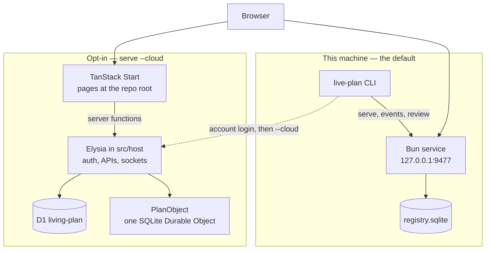

| Host | Process | What it keeps | When it runs |
|---|---|---|---|
| Local loopback | Bun, Elysia, `127.0.0.1:9477` | Every plan on this machine, in `~/.config/living-plan/registry.sqlite` | `serve` and `review` start it. `bun src/cli.ts` is this CLI |
| Web application | TanStack Start, Vite, `src/entry.ts` | HTML for `/dashboard`, `/login`, `/plans/:id`, and the other pages | `npm run dev` on local workerd, port 3000. `npm run host` is the same command. Production is the same Worker |
| Worker session | `src/host/app.ts` | Better Auth, the plan catalog, plan APIs, WebSockets | Every request the Start router does not claim, including upgrades |
| Private server | One Elysia process, its own port | One plan, no registry row | `--no-registry` only |

`dashboard`, `tui`, `logs`, and `lan` stay on the local service even when a plan is hosted in the cloud.

## The web application

TanStack Start lives at the repository root. There is no `app/` directory. `vite.config.ts` loads the Cloudflare Vite plugin, the Start plugin, and React. `wrangler.jsonc` sets `main` to `src/entry.ts`. That file exports the `PlanObject` Durable Object and is the Worker entry.

`src/entry.ts` decides who answers:

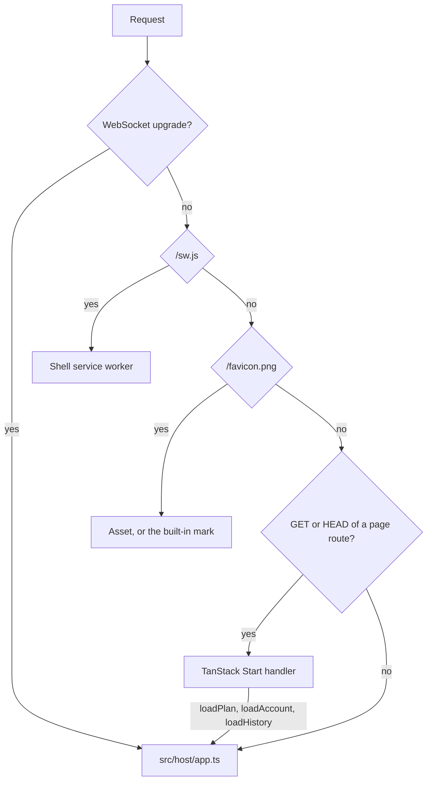

Page routes, from `src/pageRoutes.ts` and `src/routes/`:

| Route | File | What it does |
|---|---|---|
| `/`, `/review` | `index.tsx`, `review.tsx` | Redirect to `/dashboard` |
| `/login` | `login.tsx` | Email and password, or GitHub and Google. A `cli` search param finishes `account login`. Links to `/signup` |
| `/signup` | `signup.tsx` | Email, password, an optional name, or GitHub and Google. The same `next` and `cli` search params carry over. Links to `/login` |
| `/dashboard` | `dashboard.tsx` | This account's hosted plans |
| `/account` | `account.tsx` | Name, email, tier |
| `/cli-token` | `cli-token.tsx` | Signed in: mints a 30-day terminal token (`POST /api/account/cli-token`) and shows `live-plan account login --url <host> --token <token>` to copy. Signed out: redirects to `/login?next=/cli-token`. `account login --headless` prints this page |
| `/settings` | `settings.tsx` | Redirects to `/dashboard?settings=general`. Settings are a modal (`src/settings/`) that the root route opens over any page from `?settings=<section>`: General (appearance in D1), Account, Usage (`GET /api/account/usage`), and About |
| `/plans/:id` | `plans.$planId.tsx` | The plan page. `PlanShell` |
| `/plans/:id/history` | `plans_.$planId.history.tsx` | Redirects to the live plan. Versions are a menu there |
| `/plans/:id/versions/:seq` | `plans_.$planId.versions.$seq.tsx` | One saved version in `PlanShell`, read-only, with no live stream. The raw file is `/plans/:id/versions/:seq/document` on the Worker |
| `/local` | `local.tsx` | The sample plan in `PlanShell`, with no account and no Durable Object |
| `/sample` | `sample.tsx` | Signs in, opens the sample on the account, redirects to `/plans/:id` |

`/plans/:id/` is rewritten to `/plans/:id` before Start sees it. Other page paths lose a trailing slash the same way. `/client/...` on this Worker is 404. The Start bundle imports the plan client itself. The Worker does not return a second HTML copy of these pages. `src/host` keeps the session, the plan APIs, the Durable Object, and auth.

Server functions in `src/planFns.ts` call back into `src/host/app.ts` with the incoming cookie. The route never talks to D1 or the Durable Object on its own.

`npm run dev` is this application on local workerd, including the pages, D1, and the Durable Object. `npm run host` runs the same command. Apply the local migrations with `npm run host:migrate`. The Bun CLI is `bun src/cli.ts`. The library bundle the Bun service serves from `/client/` is built by `vite.client.config.ts` (`npm run build:client`).

The browser keeps a versioned shell cache, `visual-living-plan-shell-<package version>`. `src/client.tsx` is the hosted client entry. TanStack Start serves it instead of the package default, and it registers `/sw.js`. The local plan bundle (`client/main.tsx`) registers the same worker for the loopback page. The hosted Worker and the Bun service both serve that script. On install the worker reads `/precache-manifest.json` and stores the client build (scripts, styles, wasm, fonts, and images). HTML documents are requested from the network and stored only as a fallback for when that fetch fails, so a cached page is not a second copy of the plan while the host is reachable. `/` falls back to the cached dashboard. A plan page that was never stored, and any other missing document, is a short offline notice with a link back to the dashboard. `/api/`, auth, server functions, plan JSON, websockets, and downloads stay on the network and are not stored. The worker cannot read `Cookie`, so documents on one device share one cache key. Sign-out and sign-in delete those document entries and leave the assets. The next deploy bumps the package version, the worker script changes, and `activate` deletes the previous shell cache.

Both hosts also serve `/manifest.webmanifest` (`src/webManifest.ts`), and every app page links it with a light and a dark `theme-color`. With the shell worker in place, the browser offers to install Living Plan as a standalone app on a secure origin. The manifest `id` and scope stay `/`. The start URL is `/dashboard`, so the installed app opens the dashboard and keeps plan pages in its window. `handle_links: "preferred"` and `launch_handler` (`navigate-new`) ask a browser with link capturing to open an in-scope link, such as a plan the CLI opened, in a new window of the installed app instead of a tab. Icons come from `src/pwaIcons.ts` and live in `public/icons/`: round `any` icons at 64, 192, and 512px, `maskable` icons at 192 and 512px for Android launchers, a 180px Apple touch icon, and tab favicons (`/favicon.ico` included). `npm run icons` regenerates them from the logo with `@vite-pwa/assets-generator` (see `scripts/pwa-icons/README.md`). The Worker serves them as static assets and the local service reads them from `dist/icons/`. The manifest and icons are exempt from the LAN secret, like `/sw.js`. Plain HTTP on the LAN is not installable. When the app is installed, the CLI and the terminal dashboard open pages in it (`src/openUrl.ts`), unless the Mac app takes the page first ([ADR 0037](decisions/0037-plans-open-in-the-desktop-app.md)). Chromium keeps an installed app under `<profile>/Web Applications/Manifest Resources/<app id>`, and the app id is a hash of the manifest id, so the CLI finds it from the page origin. It then starts the browser with `--app-id` and `--app-launch-url-for-shortcuts-menu-item`, the same switches the app's own shortcut menu runs. With no install for that origin, or `LIVE_PLAN_OPEN=browser`, the page opens in a browser tab. `account login` always uses a tab, because sign-in returns to a loopback callback.

On a secure origin (`https`, `localhost`, `127.0.0.1`, or `[::1]`) the page also opens an OPFS database, `living-plan.sqlite`, through TanStack DB ([ADR 0026](decisions/0026-browser-offline-store.md), [ADR 0027](decisions/0027-offline-dashboard-and-owned-plans.md)). Collections hold the open plan, comments, the owned-plan warm list, the signed-in account, each dashboard period, appearance, and the saved versions of owned plans. The versions menu writes each plan's version list there, and opening `/plans/<id>/versions/<n>` adds that version's source, so the menu still lists versions offline and a version opened before opens again from the shell cache. While the dashboard is online it stores those periods and warms up to 50 owned plans, including ones not opened on this device. The settings modal opens over a cached page and reads the stored account when offline. Usage needs the network. A hosted plan page the account owns reads `GET /api/account/settings` on load, stores it as the `account` settings row, and applies it to the page. A local plan reads its own `/api/theme`. A settings change is written to the device first, also patches the stored account, and stays pending until the host accepts it. Pending changes are sent again on load and when the network returns. The host keeps the change with the newer `updatedAt`. Submissions go through an IndexedDB outbox with an `Idempotency-Key` and `baseRevision`. The local session and the Durable Object honor that key: the same key and body return the original result, and a different body is `409`. An agent edit bumps the revision and replaces the source. A person's submission does not bump it, so a queue can replay in order. The title bar shows offline, a pending count, or one failed write. Sign-out clears the device copy after warning about unsent writes. Plain HTTP on the LAN has no OPFS and no service worker, so those pages stay on the network. The registry, D1, and the Durable Object remain the authority. The browser file does not store the plan bearer, the account token, or the LAN secret.

## The Worker, D1, and Better Auth

`src/host/app.ts` is the Elysia app for everything that is not a page: `/api/auth/*`, `/api/account`, `/api/plans`, `/api/health`, plan writes, the retired view link redirect, document downloads, and WebSocket upgrades. It refuses to start when `BETTER_AUTH_SECRET` is missing. `wrangler.jsonc` marks it a required secret. Local workerd reads it from `.dev.vars` (copy `.dev.vars.example`). Production sets it with `wrangler secret put`. An upgrade is forwarded to the Durable Object before Elysia copies the response, so the Workers socket stays on that response.

Better Auth (`src/host/auth.ts`) uses the D1 binding `DB`. Email and password are always on. Google and GitHub are added when both id and secret are set. The `bearer` and `organization` plugins are on. D1 rejects `Date` and boolean bindings, so `bindableD1` turns a `Date` into an ISO string and a boolean into `0` or `1` before `bind`.

The CLI stores the raw session token from sign-in. Better Auth's bearer plugin does not turn that token back into a session, so `getSession` only sees a browser cookie. `sessionFromToken` reads `session` joined to `user` in D1.

D1 is the account database and the published plan documents, not the live plan. Migrations live in `src/migrations`.

| Table | Role |
|---|---|
| `user`, `session`, `account`, `verification` | Better Auth identity. `user.tier` is `free`, `pro`, or `business` |
| `organization`, `member`, `invitation` | Better Auth organizations |
| `plans` | Catalog row shared with the local registry: id, user, token, title, mode, status, path, timestamps, and `meta` JSON. Local rows leave `user_id` null. Tier lives in `meta` |
| `user_settings` | Account appearance in `meta`: accent, page width, diff theme, code wrap |
| `plan_versions` | Document history. `body` is the markdown. The host keeps the latest 10. Local keeps the chain |
| `plan_runs`, `plan_events` | Same tables as the local registry. The host leaves runs empty. Events on the host are the Durable Object queue |

Two credentials, and they are not interchangeable ([ADR 0022](decisions/0022-opt-in-cloud-host.md), [ADR 0028](decisions/0028-owner-only-hosted-plans.md)):

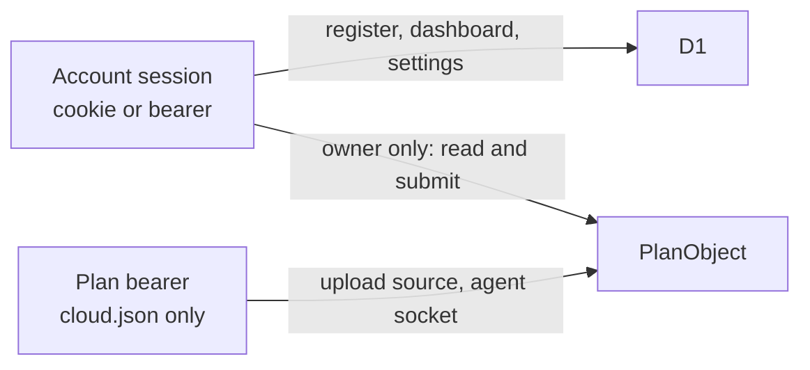

The account bearer is not written into the plan file. The plan bearer is not written there either. The CLI writes `cloudId` into the frontmatter and keeps the plan bearer in `~/.config/living-plan/cloud.json`. Only the account that owns a plan opens it. `planAccess` in `src/host/app.ts` decides that role. An old `GET /plans/:id/view/:sig` link clears its cookie and redirects to the plan page, which asks for sign-in.

Plans with an agent listening, sockets, and idle time follow `user.tier`. Free is 1 listening plan, 2 sockets, and 1 hour. Pro is 10, 4, and 6 hours. Business is 50, 50, and 6 hours. A slot is a running plan whose presence lease is fresh; open plans with no agent take none. The Worker checks it when an agent opens `/api/agent-events` and on `POST /api/plans`, and answers `402` over the cap ([ADR 0031](decisions/0031-agent-slots.md)). Saved versions are limited per account: Free 50 MB, Pro 500 MB, Business 5 GB. A publish that would pass it is `413`, and deleting a plan from the dashboard closes it and removes its versions ([ADR 0032](decisions/0032-storage-limit.md)). There is no billing screen.

## Durable Objects

Each cloud plan is one SQLite Durable Object, class `PlanObject`, binding `PLANS`. Wrangler migration `v1` creates that class. The id is `cloudId`, not a hash of the file path.

`src/host/planObject.ts` accepts the WebSocket, enforces the socket cap, and runs an alarm for idle close. Its other routes are Elysia. The SQL is `src/host/planRoom.ts`, on `this.ctx.storage.sql`.

| Stored in the object | What it is |
|---|---|
| `meta` | Token, title, mode, tier, source, revision, responses, comments, review, execution, closed flag, last seen |
| `events` | Submissions. `delivered_at` is set when the agent acks |

The page and the agent share that object's hibernating WebSockets. A local plan still uses server-sent events on the Bun process. The Durable Object holds the live session. D1 holds the account and the published document versions. Uploading source writes the Durable Object first, then `plan_versions` in D1. A stale revision is HTTP 409.

`GET /plans/<id>/api/search` is forwarded with its query to the object, which searches its live source. Saved versions are read from `plan_versions` in D1 only when `version` asks for them. The plan bearer and the owner may search every version. A viewer searches the live plan only. The local session serves the same route and the same JSON from its source and its snapshots. Both use `src/planSearch.ts`, which parses each document into blocks and is loaded lazily on the Worker.

Both dashboards search across plans with the same module. The local service answers `GET /api/dashboard/search` from `plan_versions` in its SQLite store, and the Worker answers `GET /api/account/search` from D1 for the signed-in account (`src/host/accountSearch.ts`). The search runs on the host in both cases; the page sends only the text. A dashboard search matches each plan's title as well as its blocks: terms in the title count toward every block of that plan, and a title that holds every term lists the plan on its own, ranked first. With `fuzzy=on`, which both dashboards send, `src/searchMatch.ts` also accepts a word start, one typo in a word of four to seven letters or two from eight (a swapped pair of letters is one), and words run together. An exact match always scores above a fuzzy one, and each fuzzy hit carries the ranges to highlight. Without `fuzzy` the match is the exact substring test the CLI has always used. The field searches as you type, at most once every 300 ms from two characters, cancels the request it replaces, and keeps the last results dimmed until the next arrive. A plan's newest row is its live text. Older rows are read only with `version=all`, at most 10 per plan. Plans deleted from the dashboard are left out, at most 100 plans are read, and a response stops at 200 hits. Each hit links to the plan page, or to the saved version page on the host, at `#<blockId>`.

The owner's account or the plan bearer can close a plan. Routes under `/internal/` on the object are for the Worker only, and `forwardPlan` does not pass them through. `close` sets the object closed and sets `plans.status` to `executed` with `ended_at` in D1. An idle alarm closes the object when no socket is open and last seen is older than the tier's idle time.

## A plan page

The plan file is MDX. Neither host compiles it into the HTML it sends. A Worker request cannot eval generated code, and the Bun page is the same client on purpose ([ADR 0020](decisions/0020-mdx-plan-page.md), [ADR 0023](decisions/0023-tanstack-start-page.md)). That client is `client/planMdx.tsx`.

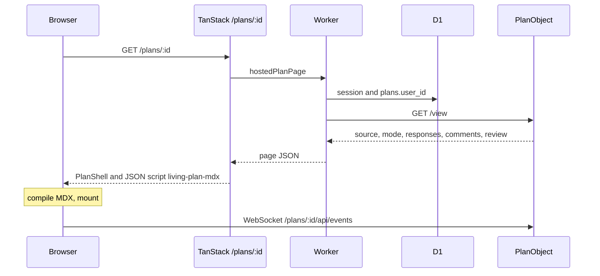

On the cloud host, `src/routes/plans.$planId.tsx` loads that JSON through `loadPlan`, then renders `PlanShell` (`src/PlanShell.tsx`). The shell is the title bar, the plan and workflow tabs, the contents list, and an empty `#plan-mdx-root`. It sets `window.__LIVE_PLAN_BASE__` to `/plans/<id>`, `window.__LIVE_PLAN_HOST__` to `cloud`, and `window.__LIVE_PLAN_TRANSPORT__` to `websocket`. After layout it imports `client/planMdx.tsx`, `client/main.tsx` (the workflow canvas), and `client/chrome/mountChrome.tsx`. A cloud host also imports the plan selector. A plan that contains a code fence imports the highlighter.

The route puts three JSON scripts on the page: `#living-plan-mdx` (source, title, responses), `#living-plan-comments`, and `#living-plan-review`. The workflow panel gets `#living-plan-bootstrap` when the loader built an execution snapshot.

`client/planMdx.tsx` reads `#living-plan-mdx`. `planSourceToMdx` strips frontmatter and rejects `` and YAML entry fences. `compilePlanMdx` runs `@mdx-js/mdx` `compile` in the page (`outputFormat: function-body`), with remark plugins for mermaid and pipe tables and a recma plugin that maps plan tags onto React components. `run` evaluates that function body with `react/jsx-runtime`. The module renders into `#plan-mdx-root`. Choice, form, questions, and approve post to `/api/interactions/:id` under `__LIVE_PLAN_BASE__`. A later `plan` or `reload` event compiles again. The compiled function is called inside one stable `PlanBody` component, with top-level blocks keyed by id, so React keeps the blocks that did not change instead of replacing the document. Code blocks render through React (`CodeBlock`, loaded lazily) for the same reason. Before a new version renders, the page records the first visible block and each block's text (`client/liveUpdate.ts`). After it renders, the page scrolls that block back to where it was, which Safari needs because it has no scroll anchoring, and flashes the innermost blocks whose text or status changed. The Workflow canvas updates statuses in place when the steps and links are the same. It fits the graph only until the person zooms or pans, keeps their view across tab switches, and pans at the current zoom to keep the active step on screen. On the hosted page `src/bindPlanChrome.ts` handles step links (`data-workflow-jump`), workflow-to-plan links (`data-plan-jump`, `window.livingPlanFocusPlanRef`), same-page section links, and Back and Forward between them, as the local page's inline script does.

The local Bun page does not use `PlanShell`. `src/render.ts` writes the same mount points and the same `#living-plan-mdx` script into an HTML string, then loads the prebuilt module from `/client/`. The browser compile is the same function. Events on that host are SSE, because the page does not set `__LIVE_PLAN_TRANSPORT__`.

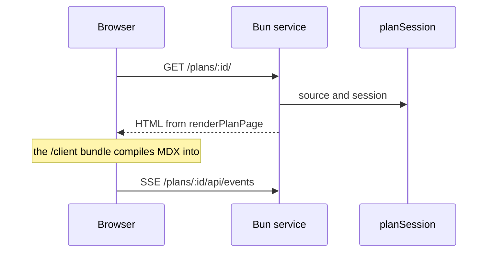

`/local` is the third surface: `PlanShell` around the rate-limit sample, `host="local"`, no base path, no account, and no Durable Object. It still compiles in the browser.

## The desktop app

`src-tauri/` is a Tauri 2 app that opens the local service, or the hosted app, in native windows ([ADR 0036](decisions/0036-desktop-app.md), [ADR 0038](decisions/0038-desktop-setup-and-cloud.md)). It is a client of those two hosts, like the CLI, not a third host. It ships for macOS 13 and later: a `.app` in a `.dmg`, signed ad hoc with Bun's entitlements (`src-tauri/Entitlements.plist`).

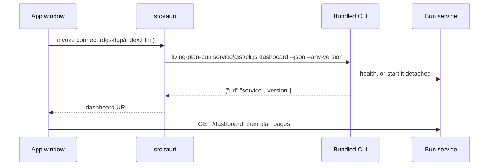

`--any-version` returns a healthy service of any version, so the app never restarts one an agent's CLI started. The window only loads pages that service renders, so they match it. When no service is running, the app's copy starts it, detached, and it keeps running after the app quits.

`bun run desktop:stage` (`scripts/build-desktop.ts`) prepares what the app ships. It bundles `src/cli.ts` into one `service/dist/cli.js` with `bun build` and copies the files the service reads beside its module at the same relative paths: `dist/client`, `dist/icons`, `planPage.css`, `shellWorker.js`, `package.json`, `docs/changelogs`, `skills/live-plan`, and elk's worker. The Bun binary becomes the sidecar `living-plan-bun`. Tauri installs it beside the app binary and ships `service/` as a resource.

The app registers the `living-plan` URL scheme ([ADR 0037](decisions/0037-plans-open-in-the-desktop-app.md)). When the CLI or the terminal dashboard opens a page on the local service, `openUrl` first asks `src/desktopApp.ts`, which turns it into `living-plan://plans/<id>` or `living-plan://dashboard` and, on macOS, runs `open` with it. `open` fails without a dialog when the app is not installed, and `openUrl` goes on to the installed web app, then a tab. In the app, `src-tauri/src/app_link.rs` reads the link. One that launched the app waits for `connect` and opens in the first window; a later one focuses the window that shows that page, or opens a new one. A link carries only an id, so it opens nothing but a page on the connected service. For a link the CLI does not launch, the manifest's `handle_links` and `launch_handler` let an installed web app take it into its own window.

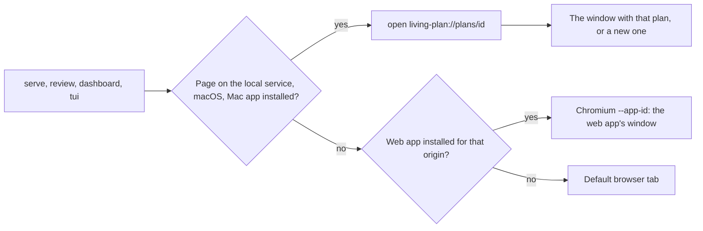

### Setup, local or cloud, and the title bar

The app's own page (`desktop/index.html`, `splash.js`, `setup.css`) is the setup screen on the first launch and the splash after that ([ADR 0038](decisions/0038-desktop-setup-and-cloud.md)). Setup is one centered step at a time, with a row of dots under the buttons: where plans run, the look, the command line tool, and agent skills. Rust holds no settings logic. Each of its commands runs the bundled CLI and returns its JSON:

| App command | Bundled CLI | What it does |
|---|---|---|
| `desktop_state` | `desktop state` | Reads `desktop.json` and reports the cloud host, the launcher, the harnesses, and the accent and syntax choices |
| `configure` | `desktop configure --json` | Saves `mode`, `cloudUrl`, `colorMode`, `accent`, `diffsTheme`, `setupDone` (`src/desktopConfig.ts`) |
| `install_cli` | `desktop install-cli` | Writes a `live-plan` launcher for the app's Bun and `cli.js` into a folder on the PATH (`src/cliLauncher.ts`) |
| `install_skills` | `skills install` | Copies `skills/live-plan` into agent harness folders (`src/agentSkills.ts`) |
| `connect` | `dashboard --json --any-version` in local mode | Returns the page to load. In cloud mode it checks that the host answers first |

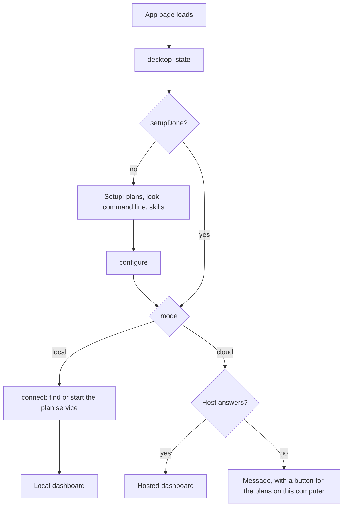

The cloud host is `desktop.json`'s `cloudUrl`, else the host in `cloud.json` that `account login` signed in to. `living-plan://cloud/plans/<id>` and `living-plan://cloud/dashboard` open pages on it, and `openUrl` uses them for a hosted page on that origin. A window shows pages of both hosts whatever the mode.

A page in an app window gets no Tauri API. `desktop/bridge.js` runs before its scripts and sets `window.__LIVING_PLAN_DESKTOP__` and `data-desktop` on the root. The page reaches the app by following a link, which `navigate` in `src-tauri/src/lib.rs` sees and cancels: `living-plan://switch/local`, `living-plan://switch/cloud`, `living-plan://setup`, and `living-plan://setup/<section>`. Those are honored only from a page in an app window, not when the system hands them over. Every toolbar carries the Local and Cloud switch (`desktopModeSwitchHtml` in `src/hostToolbar.ts`, `src/DesktopModeSwitch.tsx`), and Settings carries the setup buttons. Styles show both only under `html[data-desktop]`.

On macOS the window has the overlay title bar style, so the page's `.titlebar` is the title bar. The bridge pads it by 88px for the window buttons, gives the room back in full screen, and marks it as a drag region; a page with no toolbar gets a bare strip. When the app learns a host's origin it adds a capability for that origin with the two window permissions dragging needs, and no command of the app's own.

The accent and syntax theme chosen in setup go to the machine-wide theme file, which a plan with no `live-plan.config.json` beside it now starts from. For the hosted app, the app hands the choice to a hosted page after it loads and `src/desktopBridge.ts` saves it to the signed-in account once. The color mode is the app's window theme. A sign-in with GitHub or Google keeps its window in the app until it is back on the host.

`src-tauri/src/links.rs` decides where a link goes. A page on the service's origin, or the hosted app's, stays in the window, and `target="_blank"` to it opens another app window. Other `http`, `https`, and `mailto` links go to the default browser or mail app, and other schemes are dropped. The opener plugin's own link script is off: it sends `_blank` clicks over IPC, and service pages, a remote origin with no capability, get no Tauri API. The window title follows the page, a second launch focuses the open window, the main window's size and position are restored, and a download goes to the Downloads folder.

## How the pieces talk

A single Bun process listens on `127.0.0.1:9477`. `serve` and `review` start it when it is not already running, then register a plan. That process is detached into its own session. It keeps running after `serve`, `review`, `events`, `watch`, `wait`, `dashboard`, and `tui` exit, and after the terminal that started them closes. `serve` registers the plan, prints its URL, and returns; `serve --listen` also prints undelivered submissions and exits ([ADR 0035](decisions/0035-six-plan-commands.md)). The page stays up. Every plan command names the plan by its file or by `--url` (`src/planTarget.ts`). `review` waits for the decision and leaves the plan open. Approve and deny set that session back to watch. Iterate leaves it in review, hides the verdict bar, and marks comments that are not yet addressed as in progress ([ADR 0013](decisions/0013-iterate-keeps-review.md)). `live-plan mode` moves the same session between watch, comment, and review, and the open tab follows.

The printed URL is the bind address ([ADR 0016](decisions/0016-loopback-address.md)). On the default host that is `http://127.0.0.1:9477/plans/<id>/`. The CLI dials `127.0.0.1` and does not resolve `*.local`. `--host` other than loopback is unchanged, so a cloud agent can still share a reachable address.

LAN publishing is off until `live-plan lan on` ([ADR 0019](decisions/0019-lan-publishing.md)). That command stores the choice under `~/.config/living-plan`, listens on all interfaces when no non-loopback `--host` was set, and advertises `living-plan.local` at a private LAN address. The registry lock still tells the CLI to dial `127.0.0.1`, so `serve` and `review` keep printing the loopback plan URL. The LAN URL, printed only by `lan on` and `lan status`, carries a secret. Visiting it sets a cookie. A non-loopback request without that cookie or secret gets 401 on plan pages and plan APIs. Loopback stays open. The agent stream still requires its bearer token. `lan off` withdraws the announcement, removes a firewall rule this tool added, and binds `127.0.0.1` again.

`--cloud` is a separate host ([ADR 0022](decisions/0022-opt-in-cloud-host.md)). `account login` stores an account bearer in `~/.config/living-plan/cloud.json`. `serve --cloud` and `review --cloud` register the plan on that Worker, write `cloudId` into the plan frontmatter, and keep the plan bearer in `cloud.json`. They do not start the local registry. The page and the agent share a WebSocket on one SQLite Durable Object. `dashboard`, `tui`, `logs`, and `lan` stay local. The web application is TanStack Start at the repository root ([ADR 0023](decisions/0023-tanstack-start-page.md)). The browser still compiles the plan MDX and mounts the same React entries. The Worker keeps the account, the Durable Object, and every plan API. `npm run dev` runs that application on local workerd. `npm run host` is the same command. Setup for the Worker bindings is [docs/cloud-host.md](../cloud-host.md).

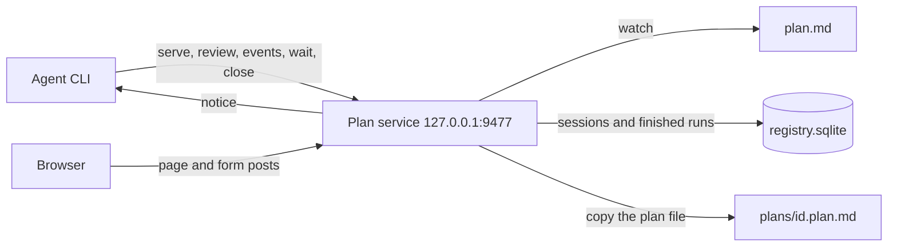

Each plan is a session under `/plans/<id>/`. The id is a stable hash of the plan path, so registering the same file again returns the same URL.

`--no-registry` does not use this service. It starts one private server for that plan, at the root of its own port. Tests and one-shot runs use that path. That process is the server. The page stops when `serve` exits, and when `review` finishes on approve or deny. Iterate leaves the private process running. The server does not register itself in the plan list. It proxies `GET /api/processes` to the service when a registry URL was passed in, so the Plans panel still works. The agent stream on that server does not require a token.

## Where a request goes

`src/registryService.ts` is an Elysia app, bound with Bun. Each path is a route handler. Paths under `/plans/<id>/` resolve that session in `src/planHost.ts` and run the handlers in `src/planRoutes.ts`. `src/planSession.ts` holds the plan state and both event streams. Everything else is the catalog, the dashboard, or shared assets.

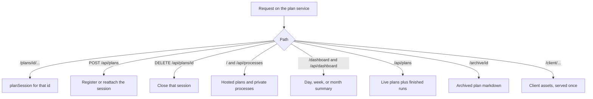

| Surface | Path |
|---|---|
| Plan page | `/plans/<id>/` (`/plans/<id>` redirects here) |
| Plan API | `/plans/<id>/api/plan`, `/api/interactions/:id`, `/api/comments`, `/api/comments/:id/address`, `/api/comments/:id/addressing`, `/api/comments/:id/reply`, `/api/review`, `/api/mode`, `/api/execution` (GET, PUT, `/start`, `/push`, `/stop`), `/api/theme` (GET, PUT) |
| Browser events | `/plans/<id>/api/events` |
| Agent events | `/plans/<id>/api/agent-events` (bearer token) and `POST /api/agent-events/ack` |
| Plan list | `/api/processes` and `GET /` |
| Private registration | `POST /api/processes`, `POST /api/processes/:id/heartbeat`, `DELETE /api/processes/:id` |
| Dashboard | `/dashboard` and `/api/dashboard?period=day\|week\|month` |
| Logs | `GET /api/logs` for the service, and `GET` and `POST /plans/<id>/api/logs` for one plan |
| Finished runs | `GET /api/plans` |
| Archived plan file | `/archive/<id>` |
| Health | `GET /api/health` |
| Client assets | `/client/...` once, for every plan |

Browser API calls from a hosted page are prefixed with `/plans/<id>`. Root `/api/...` on the service is the catalog, the dashboard, and the service log, not a plan. `new URL('/api/plan', planUrl)` is wrong when the plan URL has a path. The CLI uses `planApiUrl` in `src/agentEvents.ts`.

## Logs

Errors, warnings, and logs for development are files under `~/.config/living-plan/logs` ([ADR 0015](decisions/0015-service-logs.md)). winston writes one registry file per local day and one file per plan. The page posts browser console output and script errors to `POST /plans/<id>/api/logs` and does not render them. `live-plan logs` prints the files and does not need a running service. `GET /api/logs` reads today's registry file. Nothing in the log is a submission, so `events` does not print it. A restart leaves the files in place.

## Session lifecycle

An open session is **running**. It is restored from SQLite when the service starts, as long as the plan file is still on disk.

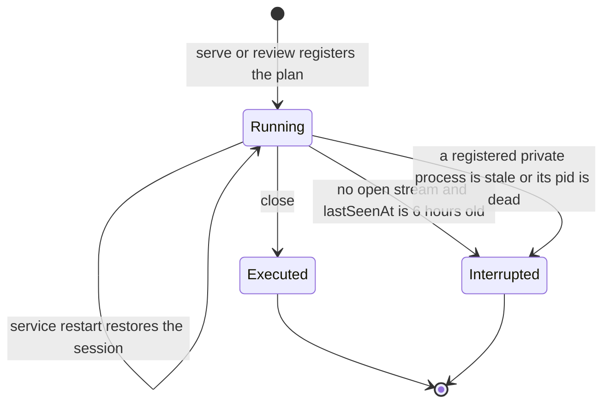

`live-plan close --url <plan-url>` and `DELETE /api/plans/<id>` close one hosted plan immediately and record it as executed. `review` records the decision and leaves the plan open. Approve and deny set the mode to watch. Iterate leaves the mode on review. A session with no open browser stream and no open agent stream is closed as interrupted once `lastSeenAt` is 6 hours old. Requests and new streams refresh that time. An open stream keeps the session up even when the timestamp is older. A private server registered with `POST /api/processes` is removed from the live list and recorded as interrupted when its heartbeat is older than 20 seconds, or when its pid is gone. `--no-registry` does not write that row.

Registering a path that is still open reattaches to that session. `serve` does not change a session that is already in comment or review. After the session is closed, registering the same path opens a new running session with the same id. The earlier run stays in `plan_runs`.

## How a person and an agent meet

The browser posts a submission to `/api/interactions/:id`, `/api/comments`, or `/api/review`. The session stores it and tells open browsers with an event named `interaction`, `comment`, or `review`. It writes a `notice` to every agent subscribed to `/api/agent-events`. The same named events are also copied onto the agent stream. The CLI reads `hello` and `notice`. A `notice` carries `event` of `interaction`, `review`, `comment`, or `edit`. An `edit` comes from `PUT /api/plan-mdx/source` when a person publishes the plan from the page editor ([ADR 0033](decisions/0033-page-editor.md)). Until then the edit is a draft in that browser's `localStorage`. On the host only the owner may publish, the Worker saves a published version, and the `edit` carries the new source, which the CLI writes into the agent's plan file. An agent upload that missed a page edit is refused with `pageEdit: true` instead of overwriting it.

A plan is active while an agent holds that stream open: `serve`, `events`, `wait`, `watch`, and `review` do while they wait ([ADR 0030](decisions/0030-agent-presence.md)). The session counts agent streams and sends open pages an `agent` event, `{ connected, clients, seenAt }`, on each change and in `hello`. The page shows a robot icon on its status chip, green while connected and struck through while not. The dashboard shows an open plan as Active with an agent connected and Idle without one. On a hosted plan the Durable Object does the same with tagged agent sockets, and keeps a presence lease on the D1 row that its alarm renews every minute.

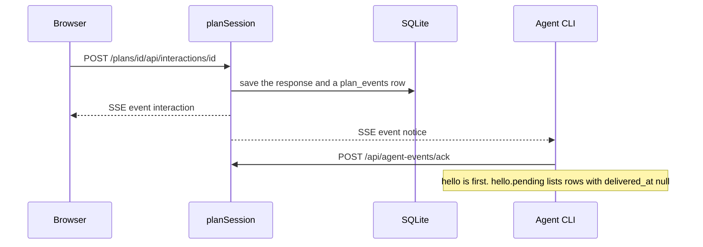

`hello` on the agent stream carries the mode, pending interaction ids, responses, review, comments, execution, and `pending`. `pending` is the `plan_events` rows for that plan whose `delivered_at` is null, in `seq` order. `events` (and `serve --listen`) print each of those as one JSON line, ack them, and exit. When none are pending they wait for the next `notice`, print it, ack it, and exit. `watch` sets watch mode and stays connected for the execution that follows an approval. It prints later submissions and does not exit. `events --follow` and `watch` also print a `mode` line when the session moves to another mode or review round, so one `events --follow` can serve a whole plan while `mode` switches it ([ADR 0034](decisions/0034-listeners-reconnect-across-modes.md)). A client subscribed to a different plan does not see them. `wait` returns when the matching interaction id arrives. `review` returns when the review `notice` arrives and leaves the plan open. Both ack the row they return. `mode` switches that session among watch, comment, and review, and `--iteration` sets the review round. Entering review clears the last verdict only after an agent acked it; until then `review` prints it at once and `POST /api/mode` with review is 409. The browser stream carries the same `mode` event, so an open tab updates in place. `serve` registers without subscribing.

Every waiting command reads the stream through one reconnect loop (`src/agentStream.ts`). A drop, a service restart, or a network change is retried with a growing wait of up to 30 seconds, and the next `hello` delivers what was sent meanwhile. A 401 re-reads the service token, which a restarted service changes. A line that pinged and then stays silent for 70 seconds is reconnected. A local service that died with its lock left behind is started again by the waiting client; one stopped on purpose is not. Only a refusal, the command's own timeout, or a stream that never connected ends it.

The agent stream on the shared service requires the plan token or the service token. The CLI reads the service token from `~/.config/living-plan/registry.json` when `--token` is omitted. Browser submission routes stay open without that token on loopback. Every request from a loopback peer must name this machine in `Host` (a loopback name, `living-plan.local`, or the `--host` value), so a DNS-rebound page is refused. A write that carries an `Origin` must come from the same host, so another website cannot submit through the browser. The CLI sends no `Origin`. Both checks are `src/requestGuard.ts` and return 403. With LAN publishing on, a non-loopback peer also needs the LAN secret before a plan page or plan API succeeds. The agent stream still checks the bearer token on every peer.

While execution is active, plan forms and review return HTTP 409. Comments stay open. Addressing a comment (`POST /api/comments/:id/addressing` or `POST /api/comments/:id/address`) updates that comment and does not insert a new `plan_events` row. Address stores an outcome of `implemented` (the default), `errored`, or `issues`. `POST /api/comments/:id/reply` appends an agent reply to that same comment and also does not insert a `plan_events` row ([ADR 0014](decisions/0014-comment-replies.md)). When an agent acks a delivered `comment` row, the comment gets `addressingAt` if it is neither in progress nor answered, so the page shows Addressing or Working without a separate call ([ADR 0035](decisions/0035-six-plan-commands.md)). `live-plan reply` appends the reply text and then addresses the comment, unless `--keep-open`. `live-plan addressing` sets `addressingAt` by hand. `live-plan address` sets `addressedAt` and the outcome (the page shows Addressed, or Implemented, Errored, or Had issues on a minibar message). The reply is saved with the session and shown on the messages minibar or that part's comment thread.

## How a page follows the plan

One connection per page, in `client/planEvents.ts`, carries every event to one hub that the page's listeners attach to: SSE on the local service, the Durable Object socket on a hosted plan ([ADR 0029](decisions/0029-page-stream-catches-up.md)). Each time it opens, the host sends `hello` with the mode, the review, and the run, so a page that was disconnected catches up without a reload. The host pings an open page every 20 seconds (SSE `ping`, or `pong` to the page's `ping`). A stream quiet for 50 seconds, refused, or closed is opened again with a backoff of up to 15 seconds, and again on `online`, on `pageshow`, and when the tab becomes visible. `client/planStatusMark.ts` turns that state into the status, the tab icon, the lock banner, and the locked plan panel on both hosts. It reads Reconnecting while the stream has been down for three seconds.

`execution start`, `push`, and `stop` post to `/api/execution/start`, `/push`, and `/stop`. The host merges the fields sent into the stored run with `applyExecutionChange` (`src/execution.ts`): `start` turns the run on, `push` keeps it as it is, `stop` turns it off and keeps the last step and graph.

After an approve verdict, or an approve gate answered yes, the run's `follow` is `armed` and the run follows the plan file (`src/runFollow.ts`). An edit of the plan file that leaves a workflow step past pending starts it; the approval, an answer, or a push alone does not. Every step done or one failed ends it, whatever started it, and it stays armed. An explicit `stop` sets `follow` to `off` until the next approval. The local session settles the run after a file reload, an answer, a verdict, and each execution change; the Durable Object does the same after an upload, a page edit, an answer, a verdict, and each execution route ([ADR 0035](decisions/0035-six-plan-commands.md)).

## Dashboard

`/dashboard` summarizes running, executed, and interrupted plans for the local day, week, or month. The page is `src/dashboardPage.ts`. The grouping is `src/dashboard.ts`. `live-plan tui` is that registry in the terminal: the running-plan list from `GET /api/processes`, and the same `GET /api/dashboard` payload with running plans listed first. Starting it starts the service when none is running. Quitting the terminal leaves the service up.

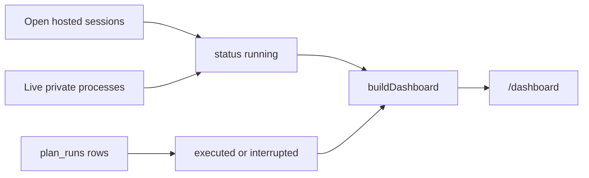

A row overlaps the selected window when it started before the end of the window and is still running, or its end falls inside the window. Finished runs are stored in `plan_runs` with typed `started_at` and `ended_at` columns. `GET /api/dashboard` selects that window in SQLite: `started_at` is at or before the window end, and `COALESCE(ended_at, heartbeat_at, started_at)` is at or after the window start. Open sessions and live private processes stay in memory. A running row overlaps when it started before the window end. A finished in-memory row uses `ended_at`, then `heartbeat_at`. Completion counts phases and interactions (`src/planProgress.ts`). A done phase or an answered interaction is one unit and an active phase is half. While a live run is pushed, a step marked in the run moves its phase forward, and a step that points at no phase or interaction is its own unit. Only a finished plan reads 100%. The hosted dashboard reads the same numbers from `plans.meta`. The Worker asks the plan object for them (`/internal/progress`) after each upload, answer, and execution update, and saves them on the row. Files modified is the git change count captured with the run. The plan markdown copied into the registry home is linked from the table at `/archive/<id>`.

## What lives where

| Module | Role |
|---|---|
| `src/planSession.ts` | One plan: plan-file and theme-config watch, parsed document, responses, comments, execution, review, submission log, browser events, agent events |
| `src/configHome.ts` | XDG `~/.config/living-plan` resolution, env overrides, and legacy home migration |
| `src/serviceLog.ts`, `src/clientLog.ts` | Development log files under `~/.config/living-plan/logs`, and the page script that posts console output into them |
| `src/planRoutes.ts` | Elysia routes for one plan, at the origin or under `/plans/<id>/` |
| `src/planHost.ts` | All sessions on the service: register, reattach, close, idle timeout, git snapshot cache, dashboard rows for open sessions |
| `src/registryService.ts` | The Elysia app: health, plan list, registration, dashboard, archive, and the hosted plan routes |
| `src/registryStore.ts`, `src/store/` | The shared SQLite schema, opened with Drizzle on bun locally and with D1 on the host. `plans.meta` holds configuration. `migrate.ts` folds older local tables into that shape |
| `src/server.ts` | The private one-plan Elysia app used by `--no-registry` |
| `src/httpServer.ts` | Binds an Elysia app with `Bun.serve` so event streams stay open |
| `src/localName.ts` | Loopback checks and HTTP origin formatting |
| `src/lanConfig.ts`, `src/lanAddress.ts`, `src/lanAccess.ts`, `src/lanFirewall.ts`, `src/lanCommand.ts` | Opt-in LAN preference, address choice, cookie gate, firewall rule, and `lan` commands |
| `src/mdnsPacket.ts`, `src/mdnsPublish.ts` | DNS-SD announcement for `living-plan.local` while LAN mode is on |
| `src/cli.ts` | Client of the service. `serve` registers and prints that plan's undelivered submissions. `events`, `wait`, `watch`, and `review` read the same stream. `logs` prints the diagnostic files under `~/.config/living-plan/logs`. `dashboard` opens `/dashboard`. `tui` reads `/api/processes` and `/api/dashboard`, and leaves the service running when it exits. `--cloud` uses the signed-in host instead |
| `src/cloudStore.ts`, `src/cloudClient.ts`, `src/cloudCommand.ts`, `src/cloudWatch.ts`, `src/cloudFrontmatter.ts` | Account session and plan bearers in `cloud.json`, frontmatter `cloudId`, upload, and the file watcher for `--cloud` |
| `src/agentEvents.ts` | SSE reader for a local plan, WebSocket reader for a cloud plan, ack helper, and `planApiUrl` used by the CLI |
| `src/entry.ts`, `src/pageRoutes.ts` | Worker entry. Pages go to TanStack Start. Auth, plan APIs, and WebSockets go to `src/host`. `GET /sw.js` is the shell worker. `GET /manifest.webmanifest` is the install manifest |
| `src/client.tsx`, `src/shellCache.ts`, `client/main.tsx` | Browser shell cache. The hosted client entry and the local plan bundle register it. Install precaches the client build. Sign-out drops cached documents |
| `src/webManifest.ts` | Web app manifest and the head tags that link it. Both hosts serve it |
| `src/offlineSync.ts`, `client/offline/` | Device copy of the open plan, the account, and each dashboard period. OPFS collections, the owned-plan warm list, the submission outbox, and the snapshot contract shared by the local session and the Durable Object |
| `src/routes/`, `src/PlanShell.tsx`, `src/planFns.ts` | The web application. Start routes, the plan shell, and the server functions that call the Worker |
| `src/host/`, `src/migrations/` | Better Auth on D1, the plan catalog, published versions, Elysia routes, and one SQLite Durable Object per plan |
| `vite.config.ts`, `wrangler.jsonc` | The Start app and its Worker bindings. `vite.client.config.ts` is the `/client/` bundle the Bun service serves |
| `src/dashboard.ts`, `src/dashboardPage.ts`, `src/tui/` | Period summary, the dashboard page, and the terminal view of the same read |
| `src/planArchive.ts` | Copy a plan file into the registry home and serve that copy |
| `src-tauri/`, `desktop/`, `scripts/build-desktop.ts`, `scripts/desktop-icon/` | The Mac app: its windows, link routing, and `living-plan://` links, the splash page that connects, the staging of the bundled CLI and Bun, and the icon |
| `src/desktopApp.ts` | Hand a local or hosted plan or dashboard to the Mac app as a `living-plan://` link, or report that the browser should open it |
| `src/desktopConfig.ts`, `src/desktopCommand.ts` | The desktop app's `desktop.json`, and the `desktop` and `skills` commands its setup screen runs |
| `src/cliLauncher.ts`, `src/agentSkills.ts` | Put `live-plan` on the PATH from the app, and copy the live-plan skill into agent harnesses |
| `src/desktopBridge.ts`, `src/DesktopModeSwitch.tsx` | What a page does inside the desktop app: save the setup look to the account, and the Local and Cloud switch |
| `src/planSearch.ts`, `src/host/hostedSearch.ts`, `src/host/accountSearch.ts` | Search a plan block by block, or every plan a dashboard lists: query terms, the live source, and saved versions when asked. One module for both hosts. `hostedSearch` is the Durable Object route, `accountSearch` the hosted dashboard's |
| `src/dashboardSearchView.ts`, `src/routes/DashboardSearch.tsx` | Dashboard search row and results. The local page script and the hosted React page share the styles and the text helpers |
| `src/parse.ts`, `src/planMdx/outline.ts` | Parse MDX plan components for the session model (interactions, workflow, progress). `` and YAML entry fences are rejected ([ADR 0021](decisions/0021-mdx-plan-entries.md)) |
| `src/planMdx/`, `src/planSnapshots.ts`, `client/planMdx.tsx`, `client/entries/`, `client/mdx/` | The plan column. The page compiles MDX and renders the React entries, Pele diagrams, ELK workflow, and TanStack charts. Source history is plan snapshots. The page shows the current file version on the description card and does not list or restore snapshots |
| `src/render.ts` | HTML shell for a plan on the Bun service: the same mount points `PlanShell` renders for a cloud plan |
| `client/planMdx.tsx`, `client/mdx/` | Browser MDX compile and the React plan. Used by `PlanShell` and by the `/client/` bundle |

## What survives a restart

The service writes each open session into `plans` in `~/.config/living-plan/registry.sqlite`. The token, path, and mode are columns. Iteration, responses, comments, execution, review, cwd, and the theme config path are keys in `meta`. Submissions are rows in `plan_events`. On startup it opens those rows again and reattaches the watchers. A missing plan file drops that session. Diagnostic logs are not in the database. They are files under `~/.config/living-plan/logs` and stay on disk across a restart.

`live-plan close`, the idle timeout, and `DELETE /api/plans/<id>` clear that session's token and its `plan_events` rows. A row that is only a session is deleted. A live process row stays until it is pruned. Stopping the service process does not. The next start restores the sessions whose plan files are still on disk. Finished runs stay in `plan_runs` and are not reopened. Live private servers are `plans` rows with a pid in `meta`. A database that still has the older `processes` table, wide columns, or `plan_sessions` is folded into this shape on open. The copied markdown stays at `~/.config/living-plan/plans/<id>.plan.md`.

When the installed package version differs from the version in the lock file, the CLI stops the running service and starts the current one. The desktop app does not: it passes `--any-version` and uses the service that is running.
