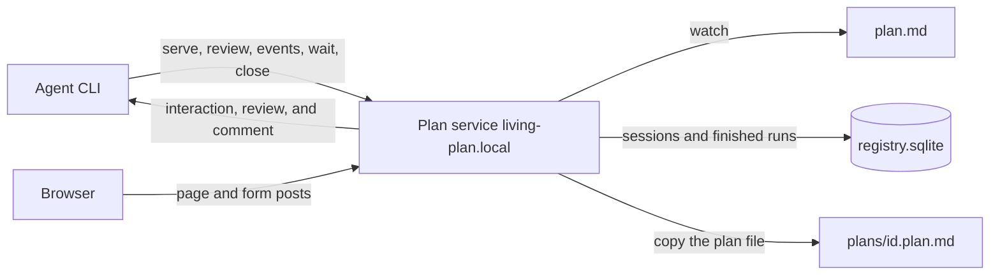
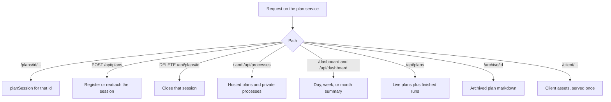
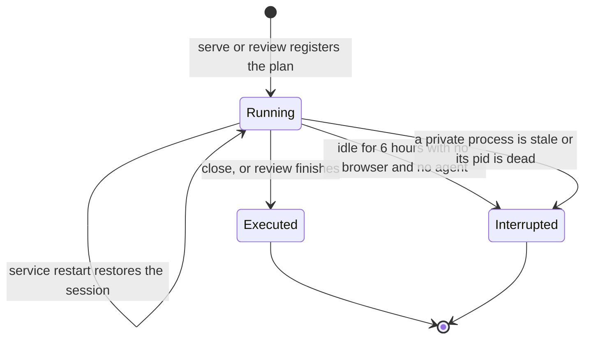
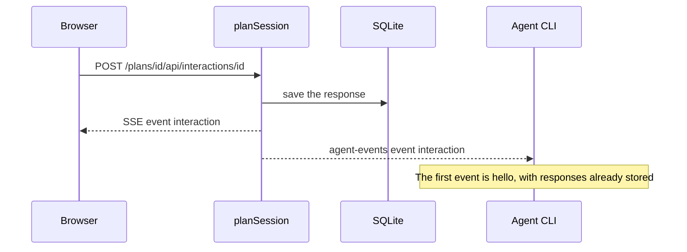
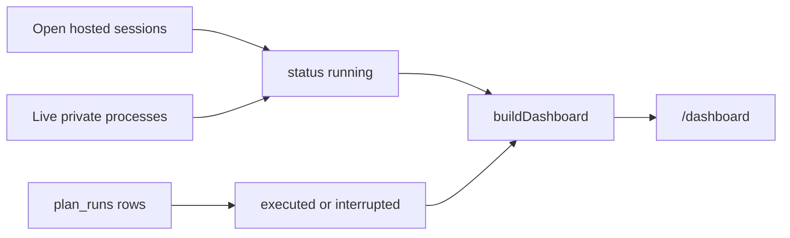

# Architecture

Visual Living Plan is a local HTTP service plus a browser page. An agent writes one `.plan.md` file. A person opens a URL on that service to watch status and submit choices, forms, questions, approvals, and reviews. The agent hears those submissions on an event stream.

Read [the decisions](decisions/README.md) for why it is shaped this way. Read [the project context](../context.md) before changing the code.

## How the pieces talk

A single process listens on `127.0.0.1:9477`. `serve` and `review` start it when it is not already running, then register a plan. That process is detached into its own session. It keeps running after `serve`, `review`, `events`, and `wait` exit, and after the terminal that started them closes. `serve` stays connected as a client of that plan and prints each submission. Stopping that client leaves the page up. `review` waits for the decision, then closes that plan.

On loopback, that printed URL uses `living-plan.local` when the name resolves only to loopback ([ADR 0010](decisions/0010-local-hostname.md)). The service adds the hosts-file line when it can. It also accepts port 80 on loopback when that port is free, so the URL can be `http://living-plan.local/plans/<id>/` with no port. If port 80 cannot be opened, the URL keeps `:9477`. The socket stays on `127.0.0.1`. `--host` other than loopback is unchanged, so a cloud agent can still share a reachable address.

Each plan is a session under `/plans/<id>/`. The id is a stable hash of the plan path, so registering the same file again returns the same URL.

`--no-registry` does not use this service. It starts one private server for that plan, at the root of its own port. Tests and one-shot runs use that path. That server proxies `GET /api/processes` to the service when a registry URL was passed in, so the Plans panel still works.

## Where a request goes

`src/registryService.ts` is an Elysia app, bound with Bun. Each path is a route handler. Paths under `/plans/<id>/` resolve that session in `src/planHost.ts` and run the handlers in `src/planRoutes.ts`. `src/planSession.ts` holds the plan state and both event streams. Everything else is the catalog, the dashboard, or shared assets.

| Surface | Path |
|---|---|
| Plan page | `/plans/<id>/` |
| Plan API | `/plans/<id>/api/plan`, `/api/interactions/:id`, `/api/comments`, `/api/comments/:id/address`, `/api/review`, `/api/execution`, `/api/theme` |
| Browser events | `/plans/<id>/api/events` |
| Agent events | `/plans/<id>/api/agent-events` (bearer token) |
| Plan list | `/api/processes` and `GET /` |
| Dashboard | `/dashboard` and `/api/dashboard?period=day\|week\|month` |
| Finished runs | `GET /api/plans` |
| Archived plan file | `/archive/<id>` |
| Client assets | `/client/...` once, for every plan |

Browser API calls from a hosted page are prefixed with `/plans/<id>`. Root `/api/...` on the service is the catalog and the dashboard, not a plan. `new URL('/api/plan', planUrl)` is wrong when the plan URL has a path. The CLI uses `planApiUrl` in `src/agentEvents.ts`.

## Session lifecycle

An open session is **running**. It is restored from SQLite when the service starts, as long as the plan file is still on disk.

`live-plan close --url <plan-url>` and `DELETE /api/plans/<id>` close one hosted plan immediately and record it as executed. `review` does the same after the decision. A session with no browser and no agent stream for 6 hours is closed as interrupted. A private `--no-registry` process that stops heartbeating, or whose pid is gone, is removed from the live list and recorded as interrupted.

The same plan path can be registered again later. That opens a new running session. The earlier run stays in the history.

## How a person and an agent meet

The browser posts a submission to `/api/interactions/:id` or `/api/review`. The session stores it, tells open browsers, and writes the same event to every agent subscribed to `/api/agent-events`.

`serve` prints each `interaction` and `review` for the plan it registered. A second `serve` or `events` on that same plan hears the same submission. A client subscribed to a different plan does not. `wait` returns when the matching interaction id arrives. `review` returns when the review event arrives, then closes that plan. `--detach` registers without subscribing.

The agent stream requires the plan token or the service token. The CLI reads the service token from `~/.visual-living-plan/registry.json` when `--token` is omitted. Browser routes on loopback stay open so the page can submit without that token.

While execution is active, plan forms and review return HTTP 409.

## Dashboard

`/dashboard` summarizes running, executed, and interrupted plans for the local day, week, or month. The page is `src/dashboardPage.ts`. The grouping is `src/dashboard.ts`. `live-plan tui` renders that same `GET /api/dashboard` payload in the terminal and lists running plans first.

A row overlaps the selected window when it started before the end of the window and is still running, or it ended inside the window. Finished runs are stored in `plan_runs` with typed `started_at` and `ended_at` columns, and `GET /api/dashboard` selects that window through Drizzle. A missing `ended_at` uses `heartbeat_at`, then `started_at`. Open sessions and live private processes stay in memory and are still filtered with the same overlap rule. Completion counts phases marked done plus interactions that already have an answer (`src/planProgress.ts`). Files modified is the git change count captured with the run. The plan markdown copied into the registry home is linked from the table at `/archive/<id>`.

## What lives where

| Module | Role |
|---|---|
| `src/planSession.ts` | One plan: file watch, parsed document, responses, execution, review, browser events, agent events |
| `src/planRoutes.ts` | Elysia routes for one plan, at the origin or under `/plans/<id>/` |
| `src/planHost.ts` | All sessions on the service: register, close, idle timeout, git snapshot cache, dashboard rows for open sessions |
| `src/registryService.ts` | The Elysia app: health, plan list, registration, dashboard, archive, and the hosted plan routes |
| `src/registryStore.ts` | SQLite through Drizzle: `plans` for private servers, `plan_sessions` for live hosted plans, `plan_runs` for finished runs |
| `src/server.ts` | The private one-plan Elysia app used by `--no-registry` |
| `src/httpServer.ts` | Binds an Elysia app with `Bun.serve` so event streams stay open |
| `src/cli.ts` | Client of the service. `serve` registers and listens for that plan. `events`, `wait`, and `review` read the same stream. `dashboard` opens `/dashboard`. `tui` reads `/api/dashboard` |
| `src/agentEvents.ts` | SSE reader and URL helper used by the CLI |
| `src/dashboard.ts`, `src/dashboardPage.ts`, `src/tui/` | Period summary, the dashboard page, and the terminal view of the same read |
| `src/planArchive.ts` | Copy a plan file into the registry home and serve that copy |
| `src/render.ts`, `client/` | The plan page. API calls are prefixed with the plan's base path |

## What survives a restart

The service writes each open session to `~/.visual-living-plan/registry.sqlite` (`plan_sessions`): plan path, mode, responses, execution, review, and token. On startup it opens those files again and reattaches the watchers. A missing plan file drops that session.

Finished runs stay in `plan_runs` and are not reopened. Live private servers are rows in `plans`. A database that still has the older `processes` table is copied into `plans` on open. The copied markdown stays at `~/.visual-living-plan/plans/<id>.plan.md`.

When the installed package version differs from the version in the lock file, the CLI stops the running service and starts the current one.
