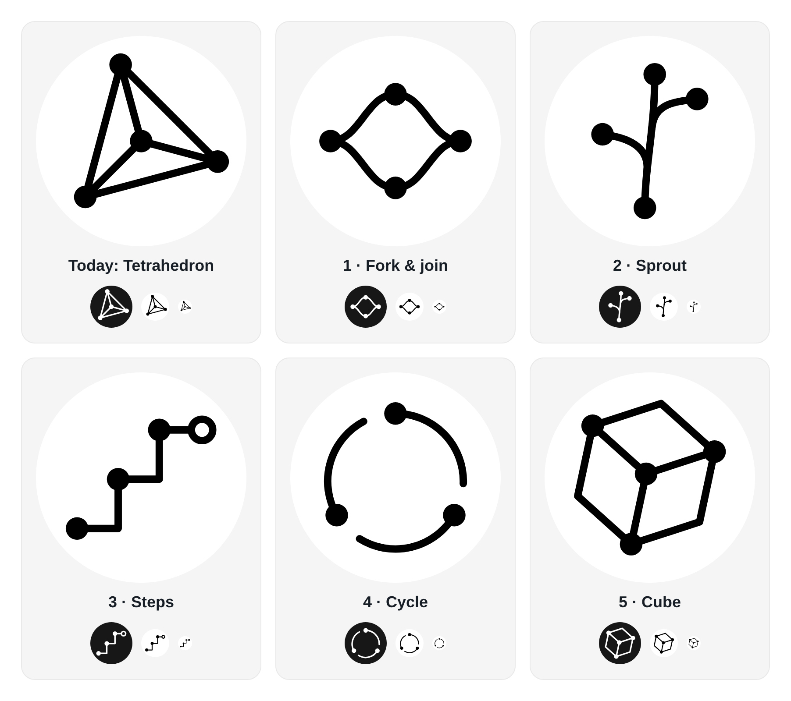

# Logo proposals

Five candidate marks to replace the tetrahedron. None of them is in use yet.

| File | Name | Idea |
|---|---|---|
| `current.svg` | Tetrahedron (today) | The current mark, rebuilt as SVG from `public/favicon.png` |
| `1-fork-join.svg` | Fork & join | The workflow splits into parallel work and meets again |
| `2-sprout.svg` | Sprout | A stem that grows new steps while the plan runs |
| `3-steps.svg` | Steps | Done phases climb as filled nodes; the open ring is the step in progress |
| `4-cycle.svg` | Cycle | Plan, review, iterate; the gaps give the direction |
| `5-cube.svg` | Cube | The tetrahedron one dimension up, at the same tilt |

All marks use the current logo's spec: a 1024 grid, 36px strokes with round caps and joins, filled nodes of radius 55, black, no letters. The open ring in Steps is radius 52 with the same stroke. Each mark is centred and spans about 740px, like the current one.

To adopt one, export it on a white circle as `public/favicon.png` (1024px), crop the mark alone to `scripts/pwa-icons/mark.png`, and run `bun run icons` ([scripts/pwa-icons/README.md](../../scripts/pwa-icons/README.md)).
