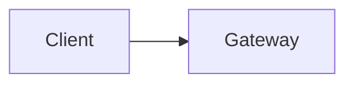

# Inline edit

The gateway keeps one window per key and returns 429 when it is full. See [the rollout](#rollout).

## Rollout

- Ship behind a flag
- Turn it on for staff

> Keep the old limiter until the new one has run for a week.

| Route | Limit |
| --- | --- |
| GET /health | none |
| POST /api/keys | 600 per minute |

<phase id="build" title="Build the limiter" status="active">
Write the limiter and its tests.
</phase>

<choice id="mode" prompt="If Redis is unreachable, how should the limiter behave?">
<option id="open" label="Fail open">
Allow traffic.
</option>
<option id="closed" label="Fail closed">
Reject traffic.
</option>
</choice>



<Endpoint method="POST" path="/api/keys/{keyId}/limit" change="added">
Set the request limit for one key.
</Endpoint>

<DataTable label="Owners">
<Column id="name" header="Name" sort />
<Column id="state" header="State" />
<Row>
<Cell>Gateway</Cell>
<Cell>succeeded</Cell>
</Row>
<Row>
<Cell>Limits</Cell>
<Cell>running</Cell>
</Row>
</DataTable>

<workflow id="flow" title="Expected execution">
```workflow
build | Build the limiter | build
mode | Choose fail mode | mode
--
build -> mode
```
</workflow>
