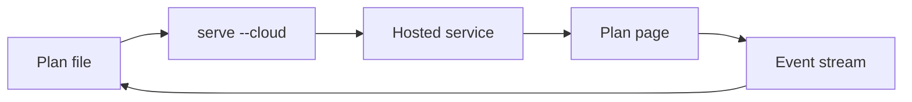

# Cloud showcase

This plan is the document. The hosted page is the view. Sign in once, then `serve --cloud` publishes the file to [plan.logspace.qzz.io](https://plan.logspace.qzz.io). Loopback stays the default until that flag is set.



<workflow id="cloud-path" title="Cloud path">
```workflow
sign-in | Sign in | sign-in | Account session
publish | Publish the file | publish | serve --cloud
follow | Follow the page | follow | events, then watch
versions | Keep the latest copies | versions | Ten versions
tour | What the page shows | tour
try-next | Try a control | try-next
audience | Who this page is for | audience
notes | A note for the agent | notes
keep-open | Keep the page open | keep-open
shown | Shown on this page | shown
--
sign-in -> publish
publish -> follow
follow -> versions
versions -> tour
tour -> try-next
try-next -> audience
audience -> notes
notes -> keep-open
keep-open -> shown
```
</workflow>

<phase id="sign-in" title="Sign in" status="done">
`account login` opens a browser and stores the account session on this machine. Later commands send that session. They do not ask again.

```bash
live-plan account login --url https://plan.logspace.qzz.io
```

The session file is `~/.config/living-plan/cloud.json`. It holds the account and, after a publish, the plan bearer. Leave that file on this machine.
</phase>

<phase id="publish" title="Publish the file" status="active">
`serve --cloud` uploads this file, prints an https URL, and writes `cloudId` into the frontmatter. It does not start the local registry, and it does not fall back to loopback.

```bash
live-plan serve examples/cloud-showcase.plan.md --cloud --detach
```

<HStack gap="sm">
<Pill tone="success">https URL</Pill>
<Pill>cloudId in frontmatter</Pill>
<Pill tone="warning">no loopback fallback</Pill>
</HStack>

The same URL is what `events`, `wait`, `watch`, `mode`, `execution`, `reply`, and `close` use. `dashboard`, `tui`, `logs`, and `lan` stay on this machine.

A later save publishes again. The host keeps the latest ten copies and drops the oldest when an eleventh arrives. The logo card shows the current file version, such as `v1`. It does not list older copies.
</phase>

<phase id="follow" title="Follow the page" status="pending">
`events` prints the next submission and exits. Start it again each time it exits, including after a comment, so a note that arrived while it was closed is not left pending.

After an approval, stop `events` and run `watch`. That switches the page to the status view and stays up while phase status and the workflow graph change. `execution start`, then `execution push` when the graph changes, then `execution stop` when the run is finished. Forms and review return HTTP 409 while execution is active.

```diff
--- a/examples/cloud-showcase.plan.md
+++ b/examples/cloud-showcase.plan.md
@@ -1,1 +1,1 @@
-<phase id="publish" title="Publish the file" status="active">
+<phase id="publish" title="Publish the file" status="done">
```
</phase>

<phase id="versions" title="Keep the latest copies" status="pending">
The dashboard links to the current plan and to the version list. A device copy of the open plan stays in the browser. Answers and comments queue while the network is down and send once when it returns. The title bar shows offline, a waiting count, or a failed write.

Settings on the hosted app can link GitHub and Google when that provider email matches the account. A loopback plan does not show that section.
</phase>

<callout id="tour" kind="note" title="What the page shows">
Plan, Workflow, and Settings share one column. Default is 720px, Wide is 1120px, and Full uses the window. Contents sits in the gutter on a wide window and behind a button on a narrow one.

A phase mark follows its status. A choice, form, questions block, or approval is listed from its prompt. A callout or checklist is listed when it has an `id`.
</callout>

<callout id="tiers" kind="tip" title="Open plans by tier">
Free is one open plan, two sockets, and a one-hour idle close. Pro is ten plans, four sockets, and six hours. Business is fifty plans, fifty sockets, and six hours.

<BarChart ariaLabel="Open plans by tier">
Free, 1
Pro, 10
Business, 50
</BarChart>
</callout>

| Tier | Open plans | Sockets | Idle close |
| --- | ---: | ---: | ---: |
| Free | 1 | 2 | 1 hour |
| Pro | 10 | 4 | 6 hours |
| Business | 50 | 50 | 6 hours |

<DataTable label="Commands that take the hosted URL">
<Column id="command" header="Command" search sort />
<Column id="role" header="Role" search sort />
<Column id="where" header="Where" filter sort />
<Row>
<Cell>serve --cloud</Cell>
<Cell>Publish this file and print the https URL</Cell>
<Cell value="host"><Pill tone="success">host</Pill></Cell>
</Row>
<Row>
<Cell>events</Cell>
<Cell>Print the next submission, then exit</Cell>
<Cell value="host"><Pill tone="success">host</Pill></Cell>
</Row>
<Row>
<Cell>watch</Cell>
<Cell>Status view for the whole run</Cell>
<Cell value="host"><Pill tone="success">host</Pill></Cell>
</Row>
<Row>
<Cell>review --cloud</Cell>
<Cell>Approve, deny, or iterate on the plan</Cell>
<Cell value="host"><Pill tone="success">host</Pill></Cell>
</Row>
<Row>
<Cell>dashboard</Cell>
<Cell>Running and finished plans on this machine</Cell>
<Cell value="machine"><Pill>machine</Pill></Cell>
</Row>
</DataTable>

<choice id="try-next" prompt="Which control should we walk through next?">
<option id="workflow" label="Workflow tab">
Open the graph and follow a step back to its section.
</option>
<option id="comment" label="A comment">
Leave a note on a section. The agent answers with addressing, reply, then address.
</option>
<option id="review" label="Review">
Switch the page to Approve, Deny, or Iterate.
</option>
</choice>

<form id="audience" prompt="Who is this page for?">
<field name="name" label="Name" type="text" required="true" placeholder="Your name" />
<field name="role" label="Role" type="select" required="true" default="author" options="author, reviewer, observer" />
<field name="plans" label="Plans to keep open" type="stepper" default="1" min="1" max="10" step="1" />
</form>

<questions id="notes" prompt="Anything the agent should remember about this showcase?">
<item>
What should the next edit to this plan make easier to see?
</item>
</questions>

<approve id="keep-open" prompt="Keep this showcase open on the hosted service?">
An approval leaves the page in the status view. A denial stops the tour. The file stays on this machine either way.
</approve>

<checklist id="shown" title="Shown on this page">
<item done="true">Sign-in and the publish command</item>
<item done="true">A workflow that points at these sections</item>
<item done="true">Phases, callouts, a chart, and both kinds of table</item>
<item done="false">A choice, a form, a question, and an approval answered on the page</item>
</checklist>
