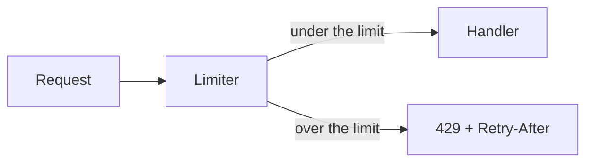

# Component showcase

Every component the plan page can draw, grouped by kind. Each phase below is one group, and each heading inside it is one component, so the contents list doubles as a catalog. The phases also show the five statuses a phase can have. Point at any block and press Edit (or E) to edit it where it sits; Apply changes saves your edits as a new version.

<Update health="on-track" by="Agent" date="2026-11-13">
This is an `<Update>`: a dated status note with a health level. Use it at the top of a long plan, or after a phase that changed course.
</Update>

<Properties>
<Prop label="Components">Plan entries, document blocks, figures, tables, layout, and labels</Prop>
<Prop label="Answer cards">Choice, form, questions, and approval, at the end</Prop>
<Prop label="Reference"><Path>skills/live-plan/primitives.md</Path></Prop>
<Prop label="Labels"><Chip>chip</Chip> <Pill tone="success">success</Pill> <Pill tone="warning">warning</Pill> <Pill tone="danger">danger</Pill> <Pill>neutral</Pill></Prop>
</Properties>

<phase id="text" title="Text, labels, and inline references" status="done">
Plain markdown is the plan's prose. A phase holds any of it, and its status shows as the circle beside the title: this one is done.

### Headings and emphasis

Text can be **bold**, *italic*, `inline code`, or a [link](https://github.com/marco-calderon/visual-living-plan). Headings from `#` to `######` structure a plan and appear in the contents list.

> A blockquote sets a remark apart from the plan's own voice.

### Lists and task lists

- A bullet list
- With a nested list:
  - one
  - two

1. A numbered list
2. Keeps its order

- [x] A markdown task list line that is done
- [ ] A line still to do. The agent ticks these in the file; the reader cannot.

### Chip, Pill, and Path

<Chip>gateway</Chip> is a chip. <Pill tone="success">succeeded</Pill> <Pill tone="warning">at risk</Pill> <Pill tone="danger">failed</Pill> and <Pill>neutral</Pill> are pills.

A `<Path>` names a file inside a sentence: the gate lives in <Path change="modified" lines="42-58">src/gateway/middleware.ts</Path>, and the limiter is new in <Path change="added">src/gateway/limiter.ts</Path>.
</phase>

<phase id="notes" title="Callouts and checklists" status="done">
### Callouts

A callout sets a note apart with a rule in its kind's color. An `icon` and a `color` are optional.

<callout kind="note" title="Context" icon="info">
A `note` is the default kind: context the reader should have.
</callout>

<callout kind="tip" title="A better way" icon="idea">
A `tip` suggests a better way.
</callout>

<callout kind="risk" title="Redis dependency" icon="alert">
A `risk` names what could go wrong and what limits it.
</callout>

<callout kind="warning" title="Before you deploy" icon="shield">
A `warning` asks for care before a step.
</callout>

<callout kind="decision" title="Bucket store, locked" icon="decision" locked>
A `decision` records what was agreed. This one also carries `locked`: it shows no Edit button, and the editor keeps it as written.
</callout>

<callout kind="note" title="Colored icon" icon="rocket" color="purple">
`color` tints the icon: blue, green, orange, red, pink, or purple.
</callout>

### Checklist

<checklist id="done-when" title="Done when">
<item done="true">A finished line, with `done="true"`</item>
<item status="active">The line being worked on, with `status="active"`</item>
<item status="blocked">A blocked line</item>
<item status="failed">A line that failed</item>
<item>A line still to do</item>
</checklist>
</phase>

<phase id="code" title="Code, diffs, and diagrams" status="active">
This phase is active: its circle is blue, and the plan header names it as the current phase.

### Code

A fence with a language is highlighted. `start=` numbers it from that line.

```ts start=40
export async function gate(req: Request, reply: Reply) {
  const key = req.headers['x-api-key']
  if (await limiter.over(key)) return reply.code(429).send()
  return next()
}
```

### Diff

```diff
--- a/gate.ts
+++ b/gate.ts
@@ -2,2 +2,2 @@
   if (!flag.enabled) return next()
-  return next()
+  return reply.code(429).send()
```

### Annotated code

<AnnotatedCode title="src/gateway/middleware.ts" start="40">
```ts
export async function gate(req: Request, reply: Reply) {
  const key = req.headers['x-api-key']
  if (await limiter.over(key)) {
    return reply.code(429).header('Retry-After', 12).send()
  }
  return next()
}
```
<Note lines="42" label="Before auth">The limiter runs before the session lookup.</Note>
<Note lines="43">Retry-After is in whole seconds.</Note>
</AnnotatedCode>

### JSON

<JsonView title="429 response">
```json
{
  "error": "rate_limited",
  "retryAfter": 12,
  "fallback": false,
  "limit": { "perMinute": 600, "remaining": 0 },
  "keys": ["k_1", "k_2", "k_3"]
}
```
</JsonView>

### Mermaid diagram


</phase>

<phase id="data" title="Tables, charts, and data views" status="pending">
This phase is pending: an empty circle.

### Markdown table

| Route | State | Owner |
| --- | :---: | --- |
| `GET /health` | succeeded | gateway |
| `POST /api/keys` | open | platform |

### Data table

<DataTable label="Operations">
<Column id="route" header="Route" search sort />
<Column id="state" header="State" filter sort />
<Column id="owner" header="Owner" />
<Row>
<Cell>GET /health</Cell>
<Cell value="succeeded"><Pill tone="success">succeeded</Pill></Cell>
<Cell><Chip>gateway</Chip></Cell>
</Row>
<Row>
<Cell>POST /api/keys</Cell>
<Cell value="open"><Pill tone="warning">open</Pill></Cell>
<Cell><Chip>platform</Chip></Cell>
</Row>
<Row>
<Cell>DELETE /api/keys</Cell>
<Cell value="failed"><Pill tone="danger">failed</Pill></Cell>
<Cell><Chip>platform</Chip></Cell>
</Row>
</DataTable>

### Bar chart and line chart

<BarChart ariaLabel="Rejects by window">
1s, 12
5s, 40
60s, 18
</BarChart>

<LineChart ariaLabel="p99 latency in ms">
Mon, 32
Tue, 35
Wed, 29
Thu, 41
Fri, 30
</LineChart>

### File tree

<FileTree title="Files touched">
<File path="src/gateway/limiter.ts" change="added">Token bucket per API key.</File>
<File path="src/gateway/middleware.ts" change="modified">Calls the limiter first.</File>
<File path="src/gateway/throttle.ts" change="deleted">Replaced by the limiter.</File>
<File path="docs/limits.md" from="docs/rate-limits.md" change="renamed" />
<File path="test/limiter.test.ts" change="added" />
</FileTree>

### API endpoints

<Endpoint method="POST" path="/api/keys/{keyId}/limit" change="added" auth="Admin API key" open>
Set the request limit for one key.

<Param name="keyId" in="path" type="string" required>Key to update.</Param>
<Param name="perMinute" in="body" type="integer" required>Requests per minute, 1–10000.</Param>

<Request>
```json
{ "perMinute": 600 }
```
</Request>

<Response status="200">Limit saved.</Response>
<Response status="404">No key with this id.</Response>
</Endpoint>

<Endpoint method="GET" path="/api/keys/{keyId}/limit" change="added" auth="Admin API key">
Read the current limit.

<Response status="200">The limit and the tokens left.</Response>
</Endpoint>

<Endpoint method="DELETE" path="/api/keys/{keyId}/limit" change="deleted">
Clear a key's own limit.

<Response status="204">Cleared.</Response>
</Endpoint>

### Data model

<DataModel title="Limiter tables">
<Entity name="rate_limits" change="added">
<Attr name="key_id" type="text" pk fk="api_keys.id" />
<Attr name="per_minute" type="integer" />
<Attr name="updated_at" type="timestamptz" nullable />
</Entity>
<Entity name="api_keys">
<Attr name="id" type="text" pk />
<Attr name="owner_id" type="text" fk="users.id" />
<Attr name="label" type="text" change="added">Shown in the admin list.</Attr>
</Entity>
<Relation from="api_keys" to="rate_limits" kind="1-1" />
</DataModel>
</phase>

<phase id="layout" title="Layout blocks" status="blocked">
This phase is blocked: a ban beside the title.

### Tabs

<Tabs label="Limiter files">
<Tab label="limiter.ts">
The bucket refills at `perMinute / 60` tokens a second.
</Tab>
<Tab label="middleware.ts">
The gate calls the limiter before the session lookup.
</Tab>
<Tab label="limiter.test.ts">
Tests cover the 429 path and the refill.
</Tab>
</Tabs>

### Compare

<Compare>
<Pane label="Before">
Every request reaches the handler, so one key can starve the others.
</Pane>
<Pane label="After">
Over the limit returns `429` with a `Retry-After` header.
</Pane>
</Compare>

### Box, stacks, and responsive rows

<Box surface="panel" padding="md">
A `<Box surface="panel">` is the one card an author asks for by name. `surface` is `plain`, `panel`, `soft`, or `inset`.
</Box>

<HStack gap="sm" wrap>
<Box surface="soft" padding="sm">An `HStack` lays out a row.</Box>
<Box surface="inset" padding="sm">Its children sit side by side.</Box>
</HStack>

<ResponsiveStack>
<Box surface="soft" padding="sm">A `ResponsiveStack` is a row on a wide window</Box>
<Box surface="soft" padding="sm">and a column on a phone.</Box>
</ResponsiveStack>
</phase>

<phase id="retired" title="A phase that failed" status="failed">
A failed phase shows an × beside its title. Leave it in the plan, so the reader sees what was tried.
</phase>

## Questions for you

These cards ask the reader for something. Each one sends an answer to the agent.

<choice id="fail-mode" prompt="If Redis is unreachable, what should the limiter do?" icon="decision">
<option id="open" label="Fail open" recommended>
Allow traffic and log a warning. `recommended` marks the option the agent suggests.
</option>
<option id="closed" label="Fail closed">
Return 429 until Redis recovers.
</option>
</choice>

A form with a text, number, select, or textarea field keeps Submit. A form of only checkboxes and steppers saves as it changes, with no Submit.

<form id="limits" prompt="Set the initial limits" icon="wrench">
<field name="max_rps" label="Max requests per window" type="number" required default="120" />
<field name="rollout" label="Initial rollout" type="select" options="1%, 5%, 25%, 100%" default="5%" />
<field name="owner" label="Owner" type="text" placeholder="Team or person" />
<field name="notes" label="Notes" type="textarea" placeholder="Anything the agent should know" />
<field name="channels" label="Alert channels" type="checkbox" options="email, slack, pager" default="email, slack" />
<field name="flag" label="Start behind a flag" type="checkbox" default="true" />
<field name="copies" label="Gateway copies" type="stepper" default="2" min="1" max="8" step="1" />
</form>

<form id="replicas" prompt="Replicas, saved as you step">
<field name="replicas" label="Replicas" type="stepper" default="2" min="1" max="8" step="1" />
</form>

<questions id="rollout-notes" prompt="Anything else before coding?" icon="help">
<item>
Which environments should get the flag first?
</item>
<item>
Is there an existing dashboard to extend?
</item>
</questions>

<approve id="proceed" prompt="Proceed with the rollout?" icon="rocket">
An approval is a yes or no gate, with an optional note for the agent.
</approve>

## Workflow

Every plan has one `<workflow>`. The Workflow tab draws it, and a live run follows it.

<workflow id="flow" title="Expected execution">
```workflow
text | Text, labels, and inline references | text
notes | Callouts and checklists | notes
code | Code, diffs, and diagrams | code
data | Tables, charts, and data views | data
layout | Layout blocks | layout
retired | A phase that failed | retired
fail-mode | Pick the failure mode | fail-mode
proceed | Approve the rollout | proceed
--
text -> notes
notes -> code
code -> data
data -> layout
layout -> retired
retired -> fail-mode
fail-mode -> proceed
```
</workflow>
