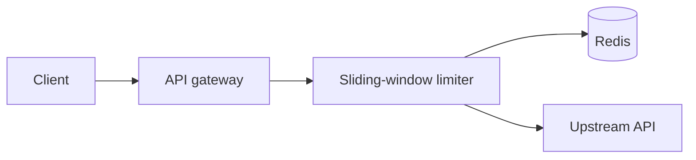
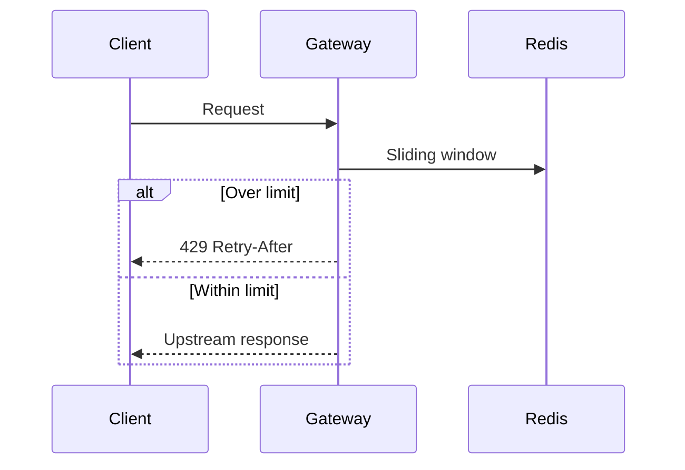

# Rate limiting rollout

We add a sliding-window limiter at the gateway, behind a flag. This living plan is the agent's status surface: phases update as work progresses, and interaction blocks pause for your direction.




<workflow id="rollout" title="Expected execution">
```workflow
design | Confirm limiter design | design
redis-dependency | Redis dependency | redis-dependency
fail-mode | Choose fail mode | fail-mode
limits | Set production limits | limits
rollout-notes | Rollout notes | rollout-notes
proceed-implement | Approval to implement | proceed-implement
implement | Implement gateway middleware | implement
observe | Ship dashboards and alerts | observe
done-when | Definition of done | done-when
--
design -> redis-dependency
redis-dependency -> fail-mode
fail-mode -> limits
limits -> rollout-notes
rollout-notes -> proceed-implement
proceed-implement -> implement
implement -> observe
observe -> done-when
```
</workflow>

<phase id="design" title="Confirm limiter design" status="done">
Use Redis for a shared sliding window. Return 429 with Retry-After when over limit.


</phase>

<phase id="implement" title="Implement gateway middleware" status="active">
Wire the limiter into the request path and add a feature flag defaulting to off.

```ts
export function gate(req: Request, next: () => void) {
  if (!flag.enabled) return next()
  if (await limiter.over(req)) {
    return reply.code(429).send()
  }
  return next()
}
```

The 429 branch, as a hunk:

```diff
--- a/gate.ts
+++ b/gate.ts
@@ -3,1 +3,3 @@
-  if (await limiter.over(req)) return reply.code(429).send()
+  if (await limiter.over(req)) {
+    return reply.code(429).send()
+  }
```
</phase>

<phase id="observe" title="Ship dashboards and alerts" status="pending">
Emit reject counts and latency, then alert on sustained 429 spikes.
</phase>

<callout id="redis-dependency" title="Redis dependency" kind="risk">
A Redis outage must not take down the API. Fail-open vs fail-closed is a human policy decision below.
</callout>

<choice id="fail-mode" prompt="If Redis is unreachable, how should the limiter behave?">
<option id="open" label="Fail open">
Allow traffic if Redis is down. Prefer availability.
</option>
<option id="closed" label="Fail closed">
Reject traffic if Redis is down. Prefer strict limiting.
</option>
</choice>

<form id="limits" prompt="Set the initial production limits">
<field name="max_rps" label="Max requests per window" type="number" required="true" default="120" />
<field name="window_s" label="Window seconds" type="number" required="true" default="60" />
<field name="rollout" label="Initial rollout percentage" type="select" required="true" default="5" options="1, 5, 25, 100" />
</form>

<questions id="rollout-notes" prompt="Anything else the agent should know before coding?">
<item>
Which environments should receive the flag first?
</item>
<item>
Is there an existing dashboard the agent should extend?
</item>
</questions>

<approve id="proceed-implement" prompt="Proceed with implementation using your answers above?">
The agent will update phase statuses in this file as it works. Keep the watch URL open to follow progress and answer any new gates.
</approve>

<checklist id="done-when" title="Done when">
<item done="false">
Middleware behind a flag
</item>
<item done="false">
429 + Retry-After behavior covered by tests
</item>
<item done="false">
Dashboard panels for rejects and latency
</item>
</checklist>
