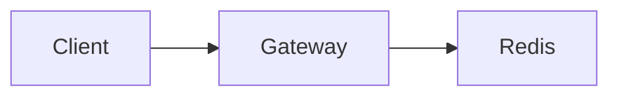

# Rate limiting rollout

Add a sliding-window limiter at the gateway. Keep the flag **off** until the [rollout notes](#rollout-notes) are in.

- Shared window in Redis
- 429 with Retry-After
- Humans choose the fail mode before implementation

> A Redis outage must not take down the API.



<Stack>
  <phase id="design" title="Confirm limiter design" status="done">
    Use Redis for a shared sliding window. Return 429 with Retry-After when the caller is over the limit.

    <callout kind="risk" title="Redis dependency">
      Fail open keeps the API up. Fail closed protects the upstream.

      <choice id="fail-mode" prompt="If Redis is unreachable, how should the limiter behave?">
        <option id="open" label="Fail open">
          Allow traffic if Redis is down.
        </option>
        <option id="closed" label="Fail closed">
          Reject traffic if Redis is down.
        </option>
      </choice>
    </callout>

    ```mermaid
    sequenceDiagram
      participant Client
      participant Gateway
      participant Redis
      Client->>Gateway: Request
      Gateway->>Redis: Sliding window
    ```
  </phase>

  <Row>
    <Box>
      <form id="limits" prompt="Set the initial production limits">
        <field name="max_rps" label="Max requests per window" type="number" required="true" default="120" />
        <field name="rollout" label="Initial rollout percentage" type="select" options="1, 5, 25, 100" default="5" />
      </form>
    </Box>
    <Box>
      <questions id="rollout-notes" prompt="Anything else before coding?">
        <item>Which environments should receive the flag first?</item>
        <item>Is there an existing dashboard to extend?</item>
      </questions>
      <approve id="proceed-implement" prompt="Proceed with implementation using the answers above?">
        Phase statuses in this file update as the work proceeds.
      </approve>
    </Box>
  </Row>

  <phase id="observe" title="Ship dashboards and alerts" status="pending">
    Weekly signups while the flag is off, so the chart is ready before traffic moves.

    <BarChart ariaLabel="Weekly signups" title="Weekly signups">
      ```chart
      Search, 84
      Direct, 63
      Referral, 47
      Social, 31
      ```
    </BarChart>
  </phase>

  <checklist title="Done when">
    <item done="false">Middleware behind a flag</item>
    <item done="true">429 and Retry-After covered by tests</item>
  </checklist>

  <workflow id="rollout" title="Expected execution">
    ```workflow
    design | Confirm limiter design | design
    redis | Redis dependency | redis-dependency
    fail-mode | Choose fail mode | fail-mode
    limits | Set production limits | limits
    implement | Implement gateway middleware | implement
    observe | Ship dashboards and alerts | observe
    --
    design -> redis
    design -> fail-mode
    redis -> limits
    fail-mode -> limits
    limits -> implement
    implement -> implement | retry
    implement -> observe
    ```
  </workflow>
</Stack>
